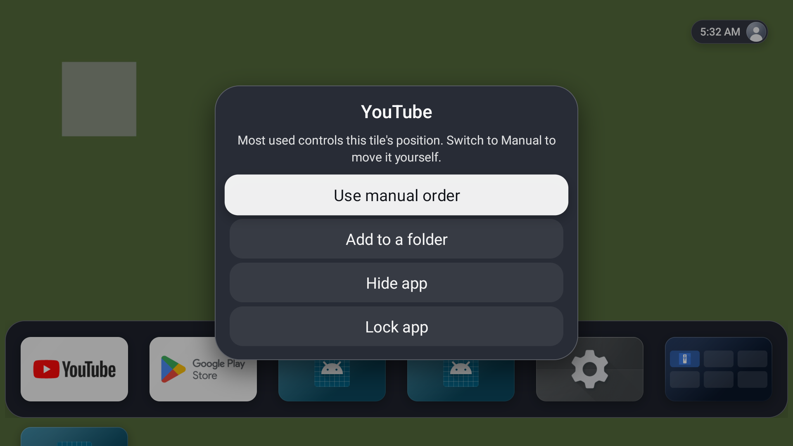
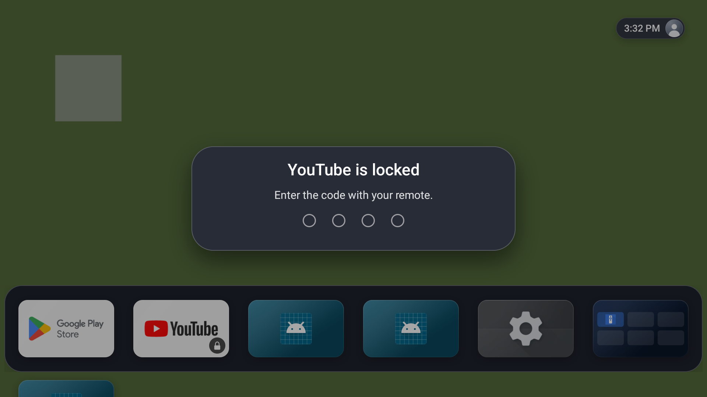
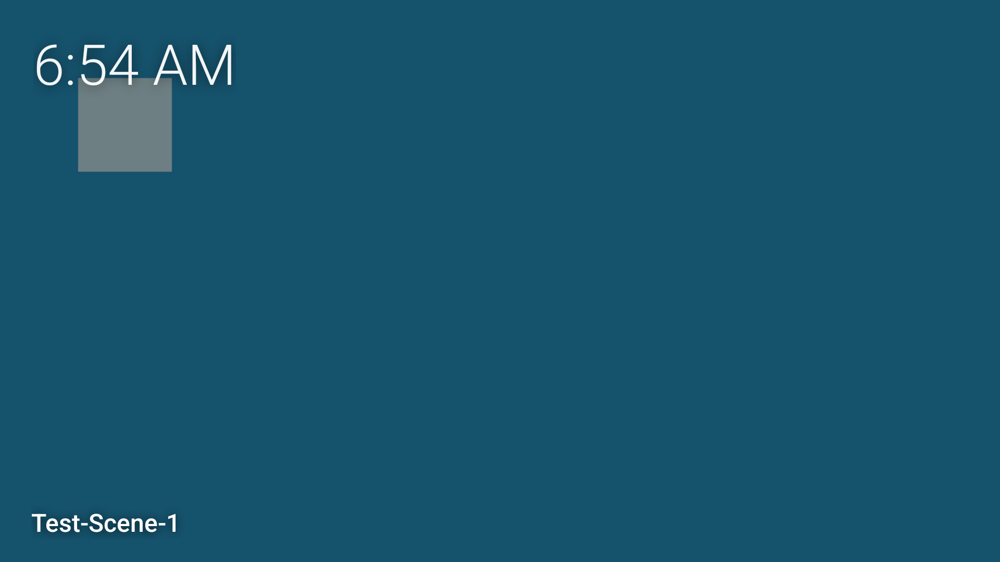
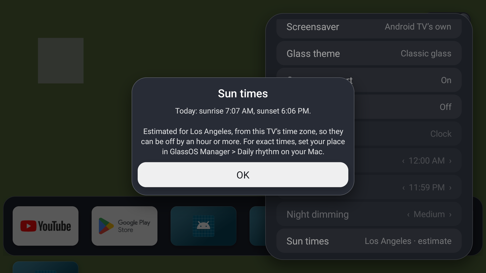
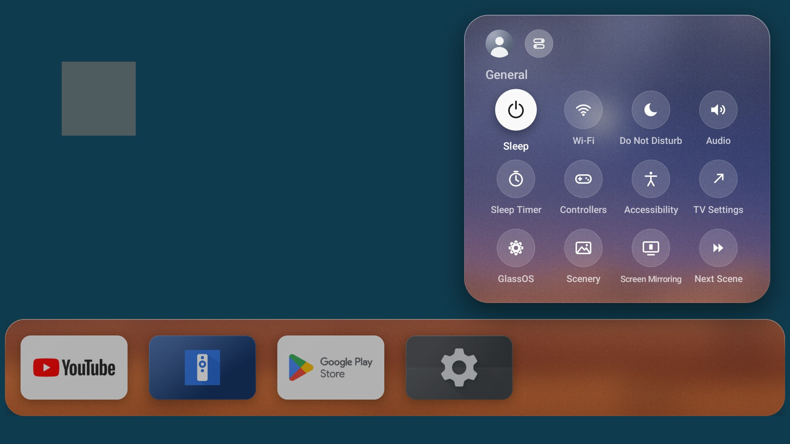
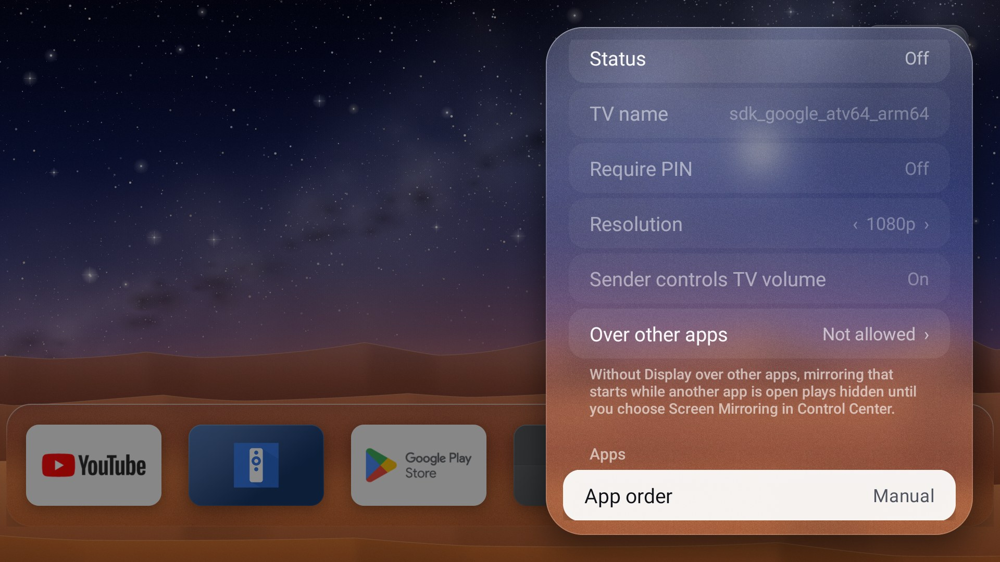
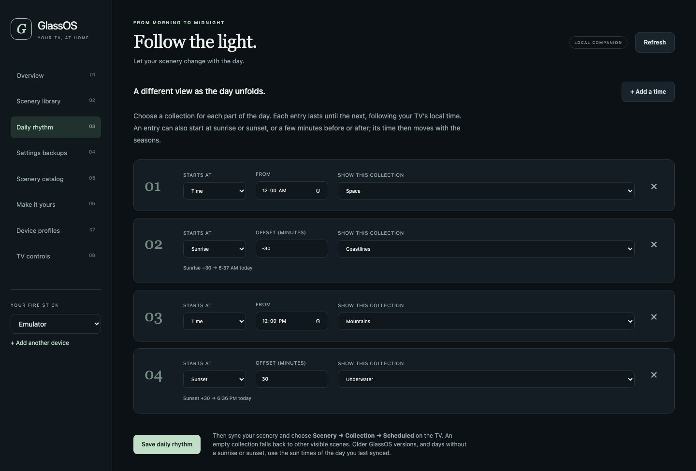
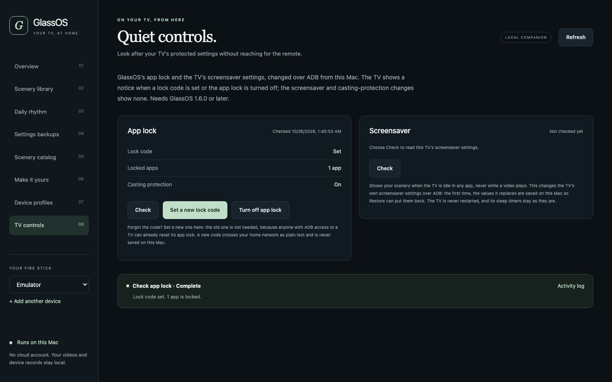

# GlassOS Aerial

**A quiet TV home screen with local aerial videos, your apps, and controls that work with the remote.**

GlassOS Aerial is a fork of **[GlassOS](https://github.com/AbhishekKaisar/glassos-tv) by Abhishek Kaisar and contributors**, started from GlassOS 1.0.2-beta in October 2026. We kept their glass home screen and built it around silent scenery: videos of your own that play behind the app icons, stay on the device, pause when another app opens and resume when you come home. Around that we added cinema and night modes, folders, themes, app ordering, an app lock, a screensaver, sun-timed schedules and a Mac companion. Screen Mirroring is in testing on `main`.


<sub>The home on the Android TV emulator, over GlassOS's built-in Dusk ocean scene. With clips in `Movies/GlassAerial` and **Settings > Top Shelf > Local aerial videos** chosen, your aerial video plays there instead.</sub>

**[Download 1.6.0](https://github.com/hnkabraham/glassos-aerial/releases/tag/v1.6.0-aerial.1)** · **[User guide](docs/USAGE.md)** · **[Mac manager](manager/README.md)** · **[Screen Mirroring](docs/SCREEN-MIRRORING.md)** · **[Fire TV launcher & privacy setup](docs/FIRE-TV-SETUP.md)** · **[Changelog](CHANGELOG.md)** · **[Validation](docs/VALIDATION.md)**

> **Release status.** The latest release is **1.6.0-aerial.1** (a GitHub pre-release, like every Aerial build), with the app lock, screensaver, sun times and TV controls on the Mac. It has so far been tested only on the Android TV emulator, not on a Fire TV; **[1.5.0](https://github.com/hnkabraham/glassos-aerial/releases/tag/v1.5.0-aerial.1)** is the last release checked on a Fire TV. **Screen Mirroring** is not in any release yet: it is on `main` only, off by default and emulator-tested. In the tables below, **Since** is the first release with the feature.

## A fork of GlassOS

[GlassOS](https://github.com/AbhishekKaisar/glassos-tv) is a calm, glassy, tvOS-inspired home screen for Android TV, Google TV and Fire TV. Everything it does is still here:

- the **Top Shelf** of full-screen art: TMDB trending titles, the unofficial Apple TV catalogue, built-in scenes or your photos (our published APK needs your own TMDB key);
- the frosted **glass shelf** of favourite apps and the **app drawer** below it;
- the **profile pill** with the time;
- **Control Center** (sleep, Wi-Fi, Do Not Disturb, audio, sleep timer and more);
- moving, re-ordering and hiding apps;
- covering the stock home so the **Home button** lands in GlassOS;
- **starting at boot** and the **first-run setup**.

GlassOS Aerial is a separate app: package `io.github.abhishekkaisar.glassos.aerial` with its own signing key, so it installs alongside upstream GlassOS and neither updates the other. Upstream releases do not contain the features below, and fixes made upstream after 1.0.2-beta are not merged yet. Our additions use the same GNU GPL v3. Please report problems with this fork in [our tracker](https://github.com/hnkabraham/glassos-aerial/issues), not upstream.

## What we added

### Scenery

| Feature | What it does | Since |
| --- | --- | --- |
| Local aerial videos | Silent, hardware-decoded clips from `Movies/GlassAerial` play behind the apps. The video decoder is released when another app opens, and playback resumes where it stopped. | 1.1 |
| Scenery browser | Poster thumbnails, next and previous, favourites, hidden scenes, scene names and shuffle without repeats. Left and Right on the Top Shelf change the scene. | 1.1 |
| Collections and daily rhythm | Group scenes by place (coast, mountains, forest, desert, underwater, space, cities) and switch collections through the day. | 1.4 |
| Playback recovery | Skips clips that stall, retries files that were repaired and picks up changed posters and titles. | 1.4 |
| **Screensaver** | Your scenery as the TV's screensaver when it is idle in any app, with scene names, the cinema clock and night dimming. Chosen and undone from the Mac manager. [How it works](docs/USAGE.md#screensaver) | 1.6 |
| **Sun times** | Night mode and daily-rhythm entries can follow sunset and sunrise, estimated from the TV's time zone or worked out for a place set from the Mac. [Details](docs/USAGE.md#sun-times) | 1.6 |

### Home and apps

| Feature | What it does | Since |
| --- | --- | --- |
| Cinema mode | After a minute without input the apps fade and the scenery takes the screen, with an optional clock. The first press only wakes the home. | 1.1 |
| Night mode | Dims the home between two times, overnight too, at three strengths. | 1.1 |
| App folders | Create, name, fill and re-order folders on the top row or in the app drawer. | 1.1 |
| Backup and restore | Your layout, folders, display and scenery choices as portable JSON, checked before anything is applied. | 1.1 |
| Lighter effects | Reduce transparency and Reduce motion, for simpler panels and navigation. | 1.1 |
| Most-used app order | Ranks the top row, drawer and folders by recent time spent. Manual mode brings back your own arrangement. [How it ranks](docs/USAGE.md#most-used-app-order) | 1.2 |
| Uninstall from Home | Hold OK on an app, choose Uninstall and confirm in the TV's own dialog, in either app-order mode and inside folders. | 1.3 |
| Glass themes and app art | Five glass palettes, your own images for app tiles, and a cinema clock that moves to a new corner each minute. [Themes](docs/USAGE.md#themes-app-artwork-and-the-moving-clock) | 1.5 |
| **App lock** | Hold OK on an app and choose Lock app. Opening it then needs a code of four remote buttons. With Usage access and Display over other apps, it is also meant to be covered when a phone casts to it or Alexa opens it (tested only with a simulated outside launch). The code and locked list never go into backups. It is a launcher lock, not a security boundary. [Limits](docs/USAGE.md#app-lock) | 1.6 |

### Mac companion: GlassOS Manager

The manager is not a separate download: run it from a checkout of this repository with `python3 manager/launch.py --data-dir "$HOME/Library/Application Support/GlassOS Manager"` (Python 3.10 or later, Android Platform Tools and FFmpeg). Its private data stays in that folder, outside the repository. It opens in your browser and listens only on `127.0.0.1`. See the [Manager guide](manager/README.md).

| Feature | What it does | Since |
| --- | --- | --- |
| Devices and backups | Named TVs, fresh settings backups and restores the TV confirms. Verified APK updates with recovery copies need a private build bundle. | 1.4 |
| Scenery library | Imports videos as silent H.264 with posters, checks every file, keeps to a storage budget and syncs with verified transfers. | 1.4 |
| Scenery catalog | Browse Aerial-compatible JSON feeds, download chosen SDR videos and compress them on the Mac. | 1.5 |
| Device profiles | Records each TV's hardware and software, keeps its latest health reports and compares checks with a saved baseline. | 1.5 |
| **TV controls** | Set a new app lock code, turn the lock off or allow casting protection, and make GlassOS scenery the screensaver and undo it, all over ADB. Needs GlassOS 1.6 on the TV. [TV controls](manager/README.md#tv-controls) | 1.6 |
| **Sun times location** | Daily rhythm entries can start at sunrise or sunset, and the manager can send the TV a place for its sun times: typed in, or looked up from ipinfo.io only when you ask. [Daily rhythm](manager/README.md#daily-rhythm) | 1.6 |

### Screen Mirroring (unreleased)

Show an iPhone, iPad or Mac screen on the TV and play its music, compatible with AirPlay. It is built from [UxPlay](https://github.com/FDH2/UxPlay) and [jqssun's Android receiver](https://github.com/jqssun/android-airplay-server) and runs in its own process. It is off until you turn it on in **Settings > Screen Mirroring** or with its **Control Center** tile, and it can require a PIN shown on the TV. It needs Fire OS 6 or Android 7.1 and later. The Mac manager can check its state (read-only), and **About > Open-source licences** shows every licence on the TV. It has passed emulator checks with simulated senders, but no real iPhone, Mac or Fire TV has been tried yet. [How it works](docs/SCREEN-MIRRORING.md)

## Screenshots

All TV captures are from the Android TV emulator. The plain colours and colour bars are generated test clips; the sunsets and starry skies are GlassOS's built-in scenes. On a TV, your aerial videos fill the background.

| | |
| --- | --- |
|  |  |
| **Scenery browser**: collections, shuffle and favourites | **Cinema mode**, with the moving clock |
|  |  |
| **Hold OK** on an app: our Uninstall and Add to a folder join GlassOS's Move and Hide | **App folders** |
|  |  |
| **App lock** from the same menu | A locked app asks for its remote code |
|  |  |
| **Screensaver**, with the scene name and clock | **Sun times**: today's sunrise and sunset, estimated from the time zone |
|  |  |
| **Screen Mirroring** tile in Control Center | **Screen Mirroring** settings: status, TV name, PIN and resolution |
|  |  |
| **App order**: Manual or Most used | **Glass theme** and display settings |

GlassOS Manager, the Mac companion, runs in your browser on the Mac:

| | |
| --- | --- |
|  |  |
| **Scenery library** | **Daily rhythm** with sunrise and sunset starts |
|  |  |
| **TV controls** for the app lock and screensaver | **Make it yours**: themes and app art |

[Validation](docs/VALIDATION.md) has before-and-after captures for every change.

## Install and add scenery

Current release: **1.6.0-aerial.1**, version code **9**. Download `GlassOS-Aerial-1.6.0.apk` from our release page. Our APK uses `io.github.abhishekkaisar.glassos.aerial` and its own signing key, so it installs alongside upstream GlassOS. Updating an earlier Aerial build with the same key preserves its settings. Screen Mirroring is not in this release; build from `main` to try it (see [Building](#building)). A self-built APK has a different signing key, so it cannot update the release in place: try it on an emulator or a spare TV, or back up your settings, uninstall and restore. If Launcher Manager points at GlassOS Aerial, restore a working Home route first.

For ADB installation, enable debugging on the TV, accept its computer authorization prompt, and substitute its address:

```sh
TV="FIRE_TV_IP:5555"
adb connect "$TV"
adb -s "$TV" install -r GlassOS-Aerial-1.6.0.apk
adb -s "$TV" shell am start -n io.github.abhishekkaisar.glassos.aerial/io.github.abhishekkaisar.glassos.MainActivity
```

Finish setup, allow storage access and select **Settings > Top Shelf > Local aerial videos**. Copy your clips and optional matching stills into this folder:

```sh
adb -s "$TV" shell mkdir -p /sdcard/Movies/GlassAerial
adb -s "$TV" push "01-coast.mp4" /sdcard/Movies/GlassAerial/
adb -s "$TV" push "01-coast.jpg" /sdcard/Movies/GlassAerial/
```

MP4, MOV and M4V files are discovered by filename; decoding depends on the TV. Our tested library uses 1080p H.264, no audio, and matching JPEG posters. Return Home or reopen Scenery after copying a new library; the Mac manager requests a refresh after syncing.

Our personal setup has **20 compressed, 90-second clips**: about **30 minutes** of scenery using **1.09 GB** including posters. The videos are not included in this public repository or APK. Supply media you have permission to use. The app does not download scenery and needs no video API or account. The published APK has no embedded TMDB key; that optional artwork source requires your own key.

**Cinema mode defaults to 1 minute** with its moving clock enabled. Choose a glass palette under **Settings > Glass theme**, or import app images through **Manager > Make it yours**. App order starts in Manual; shuffle, night mode and reduced effects start off. All controls are in Settings; Scenery is also in Control Center. See the [full guide](docs/USAGE.md) for remote shortcuts, scene metadata and permission commands.

## How we made it the Fire TV launcher

Installing the APK alone does not change Fire OS's protected Home routing. Our tested configuration uses:

| Tool | What we used it for |
| --- | --- |
| ADB from a computer | Install apps, inspect the device and verify package/Home state. |
| [GhostLock karat v1.0.4](https://xdaforums.com/t/temp-root-fire-tv-stick-4k-2nd-gen-series-karat-mantra.4798627/) | Temporary root during the original device setup, allowing protected launcher/update settings to be changed. |
| [Launcher Manager — System User Edition 2.0.0](https://xdaforums.com/t/system-user-fire-cube-stick-tv-tablet-ps7704-fireos7-rs8149-fireos8.4759215/) | Own the native Home handler and launch GlassOS Aerial, with **Custom Launcher Support** and **Proxy Launcher Mode** enabled. |

The resulting route is:

```text
Home button / startup
  → Launcher Manager: com.wolf.tn/.ui.LMUHandler
  → GlassOS Aerial: io.github.abhishekkaisar.glassos.aerial/
                   io.github.abhishekkaisar.glassos.MainActivity
```

In this configuration, GlassOS **Replace Fire TV home is Off** because Launcher Manager handles Home. The Amazon launcher package remains enabled for Fire TV Settings; its `HomeActivity_vNext` component and `com.amazon.firehomestarter` were disabled. The old upstream GlassOS package was later disabled to prevent its boot receiver competing with Aerial.

We also blocked `com.amazon.device.software.ota`, `com.amazon.device.software.ota.override` and `com.amazon.sneakpeek`. **This blocks Fire OS security updates as well as feature updates.** It preserves the tested firmware, but does not guarantee that the configuration can never be undone.

This was verified on a **Fire TV Stick 4K Max, 2nd generation (AFTKRT / karat), Fire OS 8.1.8.5, build RS8185.3891N**. Temporary root disappeared after reboot while the Home route persisted. Two later attempts to regain root failed, including one kernel panic and automatic reboot. Treat this as a record of one tested device; check the authors' current model/kernel requirements before attempting another stick.

The [detailed setup record](docs/FIRE-TV-SETUP.md) includes the exact component changes, verification commands, tool hashes, and recovery notes. On a stick where Launcher Manager already owns Home, simply select **GlassOS Aerial** as its custom launcher; there is no reason to repeat the root step for an app upgrade. On ordinary Android TV, use **Settings > Home screen > Make Home**; available methods depend on its firmware.

## What we disabled for Amazon privacy

We turned **Device Usage Data**, **Collect App Usage Data**, and **Interest-Based Ads** off through Amazon's Settings UI, then checked the stored values after reboot. We also used ADB Package Manager to disable these packages for the primary user:

| Package | Observed result |
| --- | --- |
| `com.amazon.hybridadidservice` | Advertising-ID package disabled; no matching process observed after reboot. |
| `com.amazon.wirelessmetrics.service` | Wireless-metrics package disabled; no matching process observed after reboot. |
| `com.amazon.neo.minerva` | Android package disabled, but its native service still ran. |
| `com.amazon.neo.minerva.logcat` | Android package disabled, but its native service still ran. |

`com.amazon.device.metrics` was protected by Fire OS and remained enabled. We left `com.amazon.client.metrics.api`, shared logging/framework packages and privacy cloud components intact.

**This is partial telemetry reduction, not complete removal or an irreversible lock.** The Settings switches still exist. Native Amazon services and individual apps may still collect data, and resets or firmware changes can undo the setup. We did not perform a network-traffic audit proving that telemetry stopped.

The [privacy commands and checks](docs/FIRE-TV-SETUP.md#amazon-privacy-changes) document the successful disables, the Minerva limitation, the five opt-out values and how to restore package defaults. These are device changes made separately from the launcher; installing GlassOS Aerial does not apply them.

## Move your setup to another stick

1. Install the same signed Aerial APK and copy the video/poster folder.
2. On the first TV, choose **Settings > Back up settings**.
3. Copy the exported JSON from `/sdcard/Documents/GlassOS-Aerial/` to that folder on the new TV.
4. Choose **Settings > Restore from backup** on the new TV.
5. Configure its Home route separately, using the method supported by that model and firmware.

Backups include layout, folders, display and scenery choices. They exclude credentials, personal profile details, permissions, Home routing, device identifiers and media. If shared-storage write permission is refused, backups use the app's external files folder and are deleted on uninstall; the app shows that path explicitly.

## Tested configuration

**1.5.0-aerial.1 (last release checked on a Fire TV)**

- **66 JVM tests and 36 Python tests passed**, covering launcher behavior, schedules, backup validation, local API access and transfer failures.
- Debug and signed release builds passed; lint reported **0 errors**.
- Android TV API 31 emulator: glass themes from the remote, custom app art and its fallback, the moving cinema clock and cinema wake, and a settings export with the new fields. Browser checks covered catalog feed import.
- Fire TV Stick 4K Max / Fire OS 8.1.8.5: in-place signed upgrade with settings, Home routing and all existing scenes preserved, 10 Home/Settings cycles and sleep/wake. Lifecycle checks verify decoder release on leaving Home.

**1.6.0-aerial.1 (current release) and Screen Mirroring on `main`**

- **136 app and 42 Screen Mirroring JVM tests and 97 Python tests passed**; lint reported **0 errors**; the native packaging and vendored-source checks passed.
- Android TV emulator only: app lock (including a simulated outside launch), the screensaver, sun times, the Mac's TV controls, and Screen Mirroring with simulated senders.
- The signed release APK (built without Screen Mirroring) was smoke-tested on a fresh Android TV API 31 emulator: first-run setup, Settings and Control Center with no Screen Mirroring entries, locking an app and opening it with the code, the screensaver as a preview and as the TV's screensaver, Night follows sunset and sunrise, the manager's ADB status calls and a settings backup, with no crashes.
- Not yet installed on a Fire TV. Real casts, Alexa, Amazon's Ambient Experience and real iPhone or Mac mirroring sessions are untested.

Persistent Home/startup and privacy opt-outs were checked after reboot during the earlier device setup; reboots have not been retested on a physical device since. Other physical models and older Fire OS versions are not validated. See [validation details and screenshots](docs/VALIDATION.md). The app retains minSdk 22; that is not a claim that the GhostLock/Launcher Manager method works on every supported Android version.

## Building

Use **JDK 17**, Android SDK platform **34**, and build tools **34.0.0**. Screen Mirroring's native receiver also needs **NDK 27.0.12077973** and **CMake 3.22.1** (`sdkmanager "ndk;27.0.12077973" "cmake;3.22.1"`), plus perl, GNU make, patch and python3 on the host to build OpenSSL from source. The first build downloads the OpenSSL source once (SHA-256 checked) into `.cache/airplay-downloads/`; later builds reuse it offline. To build without it, add `-Pglassos.airplay.native=false`; the feature then stays hidden.

```sh
./gradlew testDebugUnitTest assembleDebug lint
./gradlew assembleRelease
python3 -m unittest discover -s manager/tests -v
```

Debug output: `app/build/outputs/apk/debug/app-debug.apk`. Release builds are unsigned unless you configure your own keystore. Keep signing keys and API keys outside the repository. A differently signed APK cannot update our published APK in place.

The launcher deliberately targets API 28 for its existing shared-storage behavior. The Play target-SDK age lint check is disabled; other checks remain enabled. See the [build notes](docs/USAGE.md#building) and [contribution guide](CONTRIBUTING.md). AI setup instructions are in [AGENTS.md](AGENTS.md).

## Recovery and uninstalling

If Launcher Manager owns Home, **restore a working Home route before uninstalling GlassOS Aerial or Launcher Manager**. Turning off GlassOS's overlay setting alone does not undo the native route. Restore through Launcher Manager with the required privileges and verify stock Home and Settings first; details are in [recovery](docs/FIRE-TV-SETUP.md#recovery).

For a normal Android TV default-home setup, select another Home app first. GlassOS **Prepare to uninstall** removes its optional device-admin state. Shared Documents backups and Movies clips remain after uninstalling; app-private backups do not.

## Credits and license

- **Abhishek Kaisar and contributors:** [upstream GlassOS](https://github.com/AbhishekKaisar/glassos-tv), the foundation of this fork.
- **Screen Mirroring:** [UxPlay](https://github.com/FDH2/UxPlay), [jqssun's android-airplay-server](https://github.com/jqssun/android-airplay-server), [libplist](https://github.com/libimobiledevice/libplist), OpenSSL and [Oboe](https://github.com/google/oboe), each under its own licence ([THIRD_PARTY_NOTICES.md](THIRD_PARTY_NOTICES.md)).
- **GhostLock and Launcher Manager authors:** the separate device tools linked above. They are not bundled with our APK.
- **Feature references:** [Projectivy](https://github.com/spocky/miproja1) and [Arc](https://github.com/meddouribadis/arclauncher) informed the personalization ideas; [Aerial Views](https://github.com/theothernt/AerialViews) and [Aerial Community](https://github.com/AerialScreensaver/AerialCommunity) informed the feed workflow. These are independent implementations; their apps and media are not bundled.
- **This fork:** local aerial playback and the controls documented here. File fork-specific issues in [our tracker](https://github.com/hnkabraham/glassos-aerial/issues).

**GNU GPL v3.0**: see [LICENSE](LICENSE). Release source bundles come from `tools/airplay/make_source_bundle.sh`. Independent project; not affiliated with Amazon, Google or Apple. Fire TV, Android TV, Apple TV, AirPlay, iPhone, iPad and Mac are their respective owners' trademarks; Screen Mirroring is compatible with AirPlay but not endorsed or certified by Apple. The optional TMDB integration is not endorsed or certified by TMDB; streaming availability data comes through TMDB/JustWatch.
