# GlassOS Aerial 1.5.0-aerial.1 validation

Validated on October 24, 2026. Package `io.github.abhishekkaisar.glassos.aerial`, version code 8.

## Automated checks

**66 JVM tests and 36 Python tests passed.** Debug and signed optimized release builds passed; lint reported **0 errors, 115 warnings**. JavaScript syntax passed. New tests cover backwards-compatible appearance backups, strict theme/boolean validation, clock positions, feed shape/size limits, SDR preference and deduplication, unsafe URL/private-address rejection, interrupted-download cleanup, failed-feed preservation, icon filename traversal and health diffs.

## Catalog, personalization and profiles

The browser loaded the live Aerial Community feed (20 supported entries), searched for Bixby Creek Bridge, assigned Coastlines and downloaded/compressed the selected source. The source was shorter than the requested 90-second maximum: output was 54.87 seconds, silent H.264, with a poster; total 22,891,838 bytes. Verified sync copied the two new files and skipped all 40 existing videos/posters. There are now 21 clips on the tested stick. Third-party video files remain private and are not included in this repository or release.

On Android TV API 31, remote Left/Right changed glass themes immediately; the custom-art switch preserved original icons. The browser file picker imported a neutral PNG, and manager sync updated real fixture app tiles without restarting GlassOS. A damaged PNG fell back to the app's original resources; Restore original removed only the chosen manager-owned image. A fresh settings export included the theme, custom-art switch and clock movement. JVM checks verify these preferences round-trip and older backups leave them unspecified.

Cinema mode was allowed to enter naturally. On a real minute tick, the clock moved from bottom left (`[64,887][513,1032]`) to top left (`[64,48][513,193]`) within the 1920 × 1080 screen. The first OK woke Home without opening an app. These are discrete moves, not continuous animation or a burn-in guarantee.

The physical device baseline recorded the old version, model/ABI/RAM, firmware, native Home handler, privacy values and blocker identity. After the upgrade, the comparison correctly reported only the GlassOS version change; free storage was reported separately. The baseline remains the pre-upgrade state. No firmware, root, Home-route, privacy or permission changes were applied.

| Before: Classic glass | After: Forest palette |
| --- | --- |
| 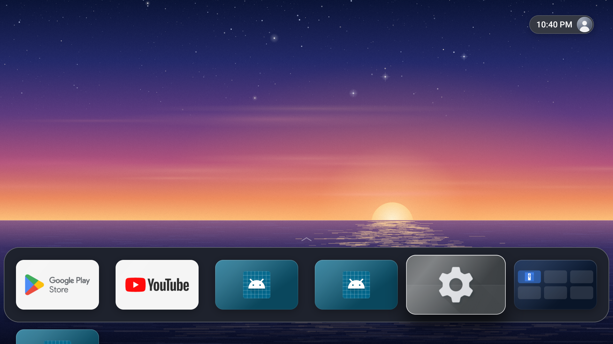 | 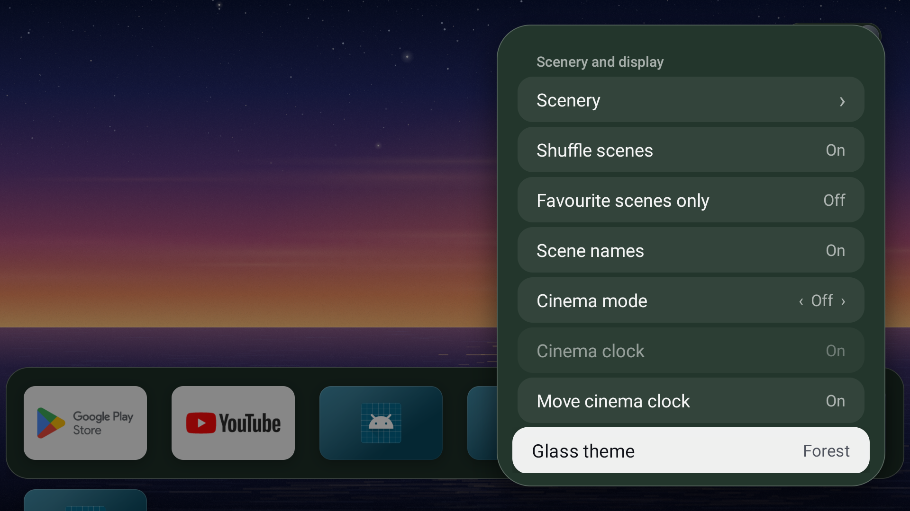 |

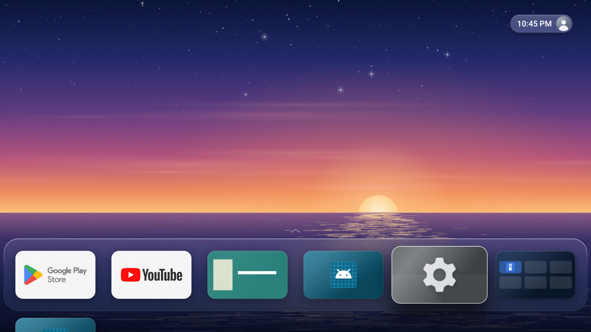

| Cinema clock before minute tick | After minute tick |
| --- | --- |
| 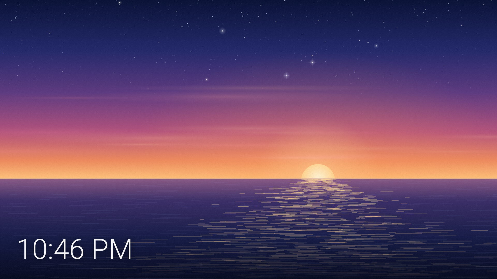 | 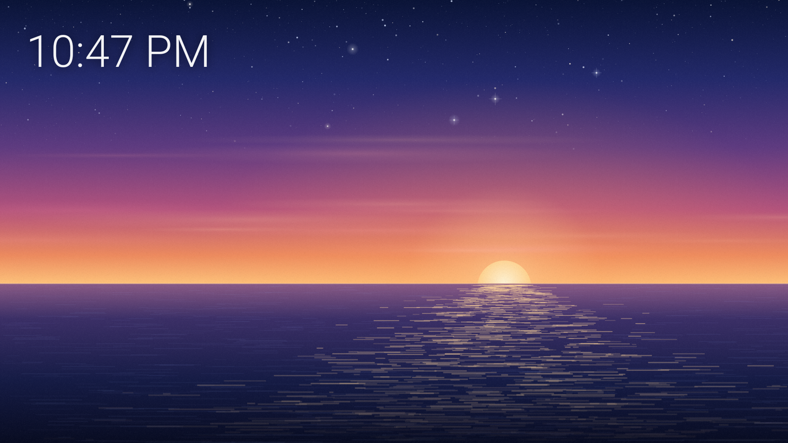 |

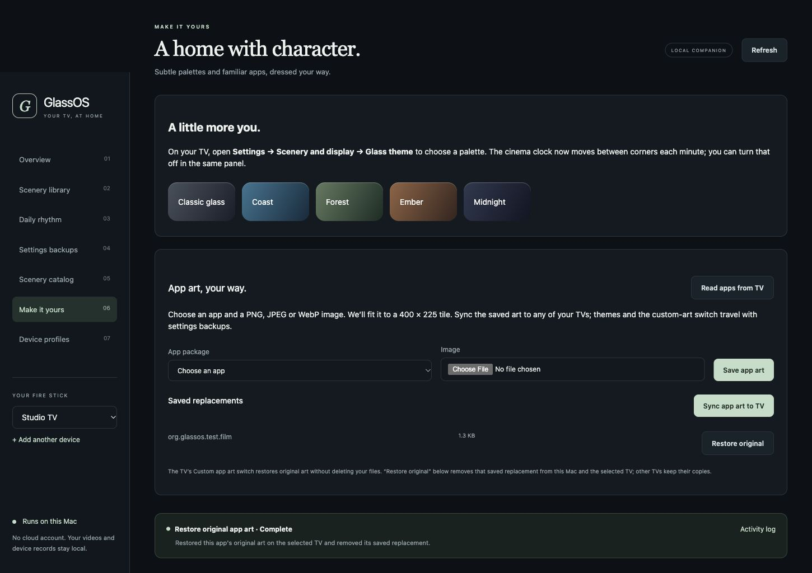

## Physical Fire TV lifecycle and upgrade

Fire TV Stick 4K Max (2nd generation, AFTKRT), Fire OS 8.1.8.5 / RS8185.3891N. The manager saved the previous APK and a fresh settings backup, verified the certificate and target APK hash, and installed with `adb install -r`. A fresh post-upgrade backup matched the original layout, folders, scenery and existing display values exactly. Only the new default appearance fields were added. All five recorded privacy values remained off, four tracked packages remained disabled and the three Instagram blockers still matched their saved APK hashes.

**10 Home/Settings cycles and sleep/wake passed.** The media player was released while away and resumed on return; per-cycle app PSS ranged from 87,707 to 97,063 KB. These short samples do not establish overnight stability or account for all decoder/GPU memory.

## Before/after performance on the same physical stick

Five samples per release, five-second settling periods, the same existing 20-clip library and display preferences; the new clip was synced afterward. The initial run while the TV was dozing was discarded. The reusable [benchmark tool](../tools/benchmark_launchers.py) now refuses to measure a sleeping device. No Home routing or app data is changed.

| Median | 1.4.0-aerial.1 | 1.5.0-aerial.1 |
| --- | ---: | ---: |
| Cold activity `TotalTime` | 446 ms | 449 ms |
| Return from Settings `WaitTime` | 174 ms | 139 ms |
| App PSS | 111,430 KB | 110,804 KB |

These results show similar resource use in this short run, not a demonstrated speed improvement. `am start -W` reports Activity launch timing, not first usable video frame. Shared video decoder allocations can be attributed outside the app. Device state, caches and different selected clips introduce noise.

## Limits

Other physical models, Fire OS 5/6/7, reboot persistence and a fresh privileged Home setup were not retested. Custom imagery and malicious-file cases used the emulator, not personal apps or files. Feed providers can change URLs or remove media. The manager's profile checks recorded configuration rather than network traffic. The current signing key and compiled empty TMDB key are retained.

---

# GlassOS Aerial 1.4.0-aerial.1 validation

Validated on October 24, 2026. Package `io.github.abhishekkaisar.glassos.aerial`, version code 7.

## Build and automated checks

**63 JVM tests and 28 Python tests passed**, with no failures or errors. Debug and signed optimized release builds passed; lint reported **0 errors, 113 warnings**. JavaScript syntax and Python lint checks passed. The release retains the existing signing certificate and an empty compiled TMDB key.

New coverage includes collection selection and midnight-wrapping schedules, invalid schedule/backup input, playback progress timeouts, interrupted transfers and retries, failed remote hashes, corrupt local sources, low-space refusal, storage budgets, unchanged-file skipping, and metadata publication after successful transfers. Companion tests also cover authenticated API access, Host/Origin checks, traversal refusal, upload limits, serialized jobs, stale backup rejection and invalid APK identity rejection.

## Mac companion

The real browser UI was exercised against an Android TV API 31 emulator. A generated video with audio was uploaded through the file picker, encoded by FFmpeg, fully decoded for validation and inspected as silent H.264 with a JPEG poster. Collection filtering, title/category edits, daily schedule editing and persistence, checked sync, fresh backup export and restore handoff were exercised. Cancel on the TV preserved its settings; confirming Restore applied the copied backup. Final browser checks verified all 20 saved collection previews loaded after reopening and Refresh; preview requests are bounded and retry transient failures.

These captures use generated test videos and a neutral test-device name. Private addresses, tokens, device logs, backups and third-party video files are excluded from the repository.

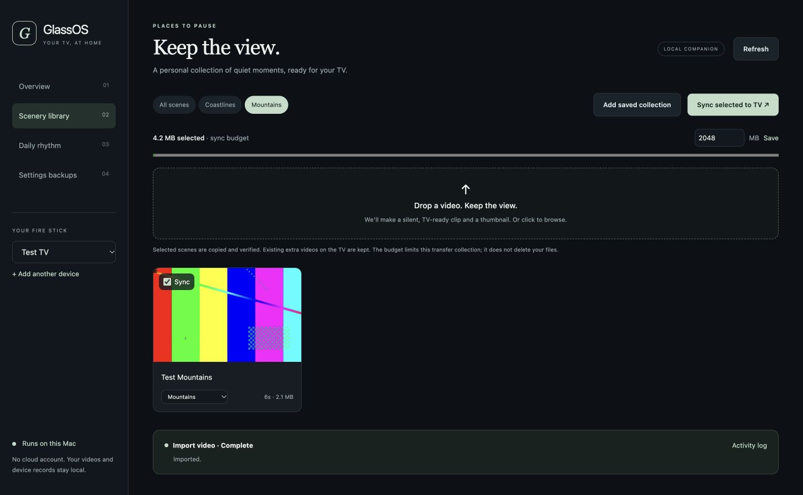

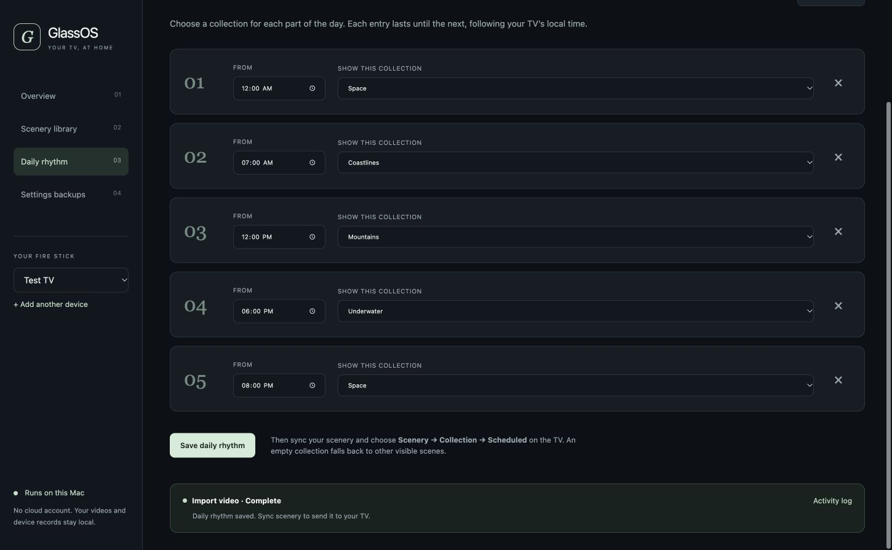

## TV scenery and recovery

Android TV API 31 remote checks covered collection selection, Scheduled mode, changed schedule loading without a restart, metadata refresh while the browser was open, corrupt-clip skipping, decoder release with no available clips, and recovery after replacing a failed clip at the same filename. The original emulator library and preferences were restored after these controlled fixtures.

| Before: scenery controls | After: collection and refreshed metadata |
| --- | --- |
| 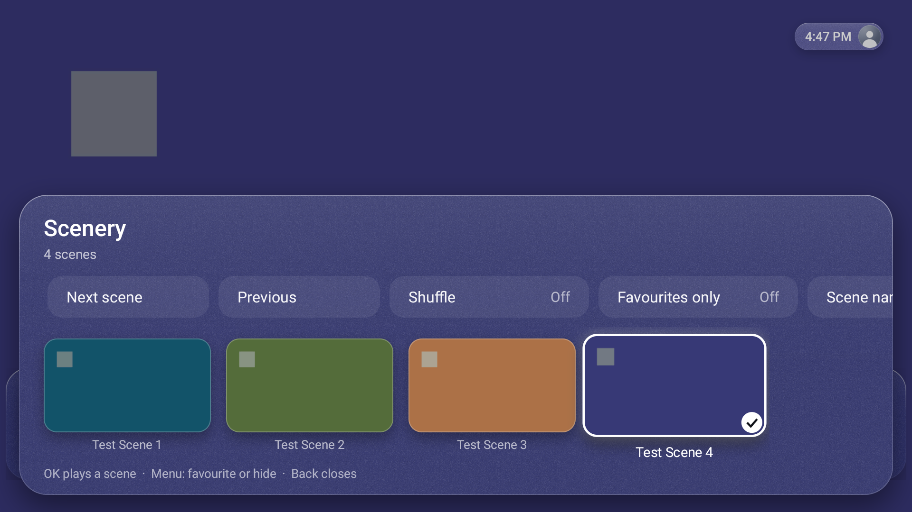 | 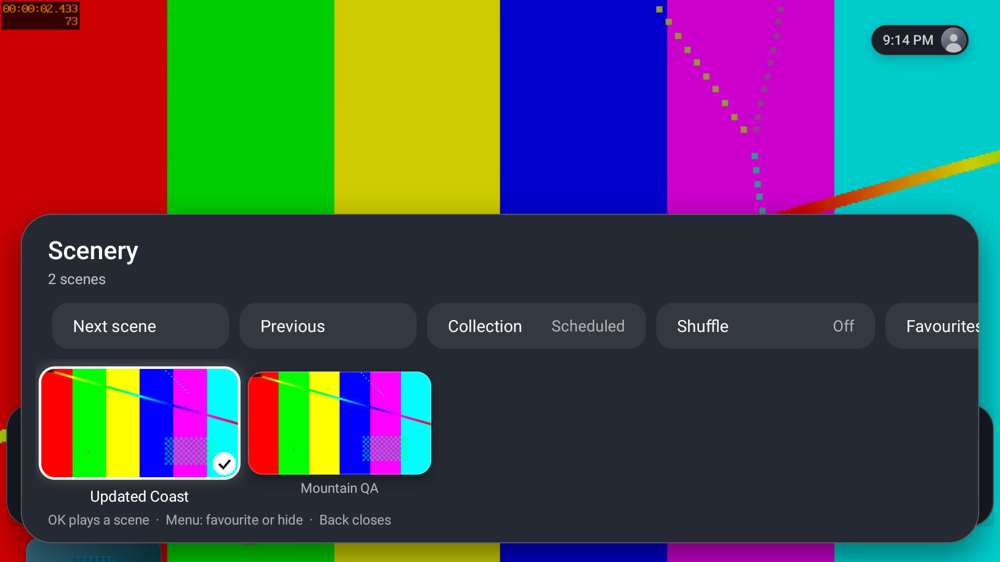 |

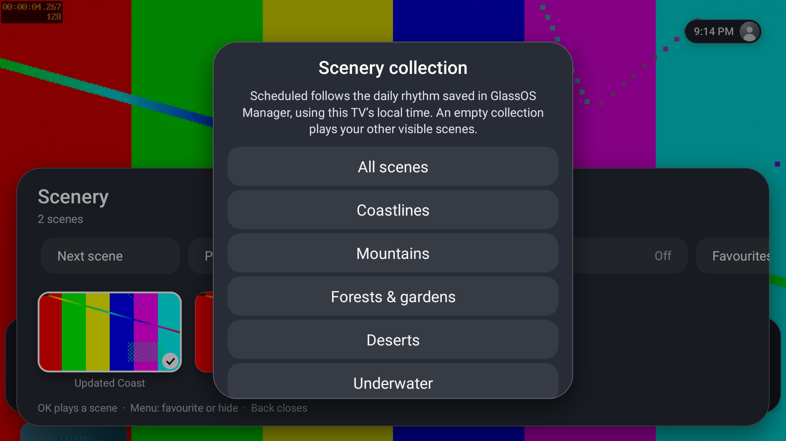

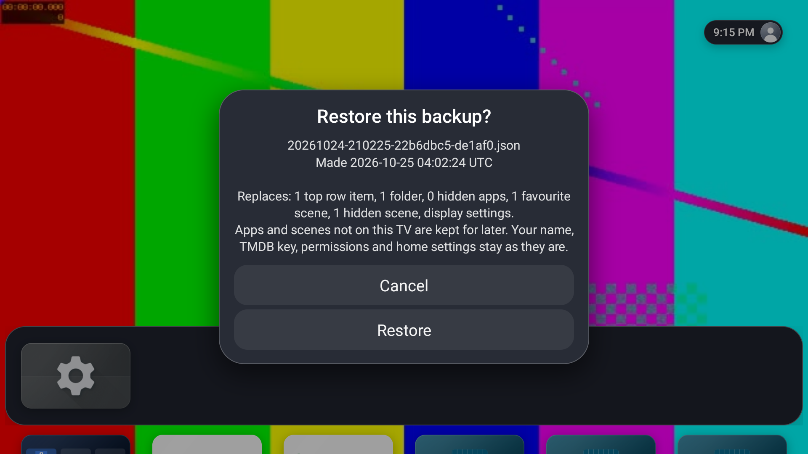

## Lifecycle and physical Fire TV

Fire TV Stick 4K Max (2nd generation, AFTKRT), Fire OS 8.1.8.5.

- The manager archived the previous APK and settings, installed the signed release in place and verified the installed APK hash. Layout, folders, display preferences, favourites and Most used mode were preserved. Collection mode remains All scenes unless Scheduled is selected on the TV.
- All 20 videos and 20 posters matched their existing hashes, so sync skipped recopying them and transferred only scene metadata and the daily schedule.
- **10 Home/Settings cycles plus sleep/wake passed on the physical stick; 12 cycles plus sleep/wake passed on the emulator.** The media service showed decoder release while away and active playback on return. No crash was observed.
- Physical per-cycle PSS samples decreased from 104,234 KB to 101,267 KB. These are short-run samples, not proof that memory cannot grow during longer use.
- Four physical playback samples over one minute showed `OMX.MTK.VIDEO.DECODER.AVC`, muted playback and zero reported dropped frames. Pressing the native Home button from Settings returned to GlassOS.
- The installed-package list, disabled-package list, native Launcher Manager Home handler, five Amazon privacy values (all `0`) and three existing Instagram blocker APKs were preserved. Usage access remained allowed. No root, firmware, Home-routing or privacy changes were made for this release.

## Limits

Fire OS 5/6/7 and other physical models were not exercised; minSdk 22 is retained. Reboot and fresh Home setup were not retested. Interrupted transfer and low-storage behavior were tested with controlled subprocess fixtures, not by filling or disconnecting the physical stick. Missing/corrupt media tests used the emulator. Playback evidence samples a short run, not every complete clip or an overnight soak. The manager does not delete existing extra videos, automatically download media or apply system-level privacy/Home changes.

---

# Earlier release: 1.3.0-aerial.1

Validated on October 24, 2026. Package `io.github.abhishekkaisar.glassos.aerial`, version code 6.

## Build and automated checks

All **57 JVM tests passed**, with no failures or errors. Debug and optimized signed release builds passed; lint reported **0 errors, 113 warnings**. The release retains the previous signing certificate and has no embedded TMDB key. The standard `REQUEST_DELETE_PACKAGES` permission requests the OS confirmation, with no silent-delete privilege.

## Remote UI on Android TV API 31

- Held OK opens the actions menu in Manual and Most used mode; releasing the held key does not select an action.
- Uninstall opens the system dialog for the selected disposable fixture. Back cancels, preserving its installation and all preferences. Confirming removal deletes the fixture and updates the grid without restarting GlassOS.
- Manual > Move still moves tiles; Back restores the original layout. Uninstalling does not overwrite saved manual order.
- A folder member supports both held OK and Menu. Confirmed removal updates the visible membership; saved membership remains available for a later reinstall. Folder tiles offer Remove folder, with no Uninstall action.
- The system Settings app has no Uninstall action. All menu rows and the native confirmation were visually checked at 1920×1080.

These are neutral emulator captures using generated clips and local fixture apps.

| Before | After |
| --- | --- |
| 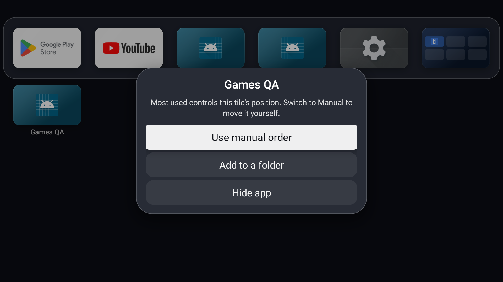 | 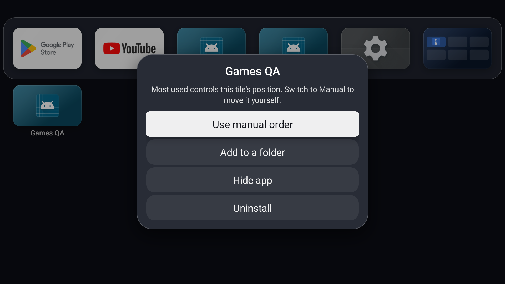 |

| Manual mode | Folder member |
| --- | --- |
| 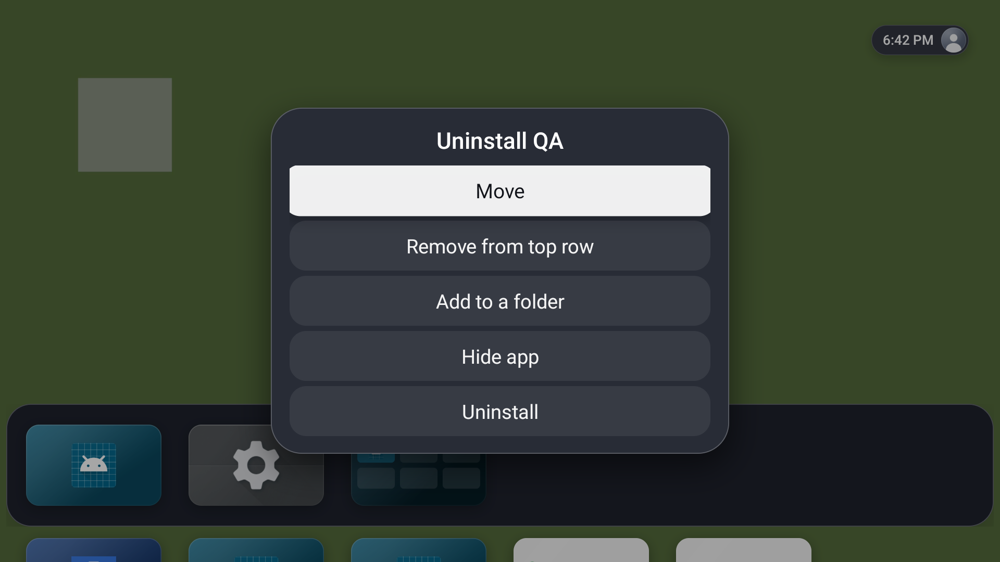 | 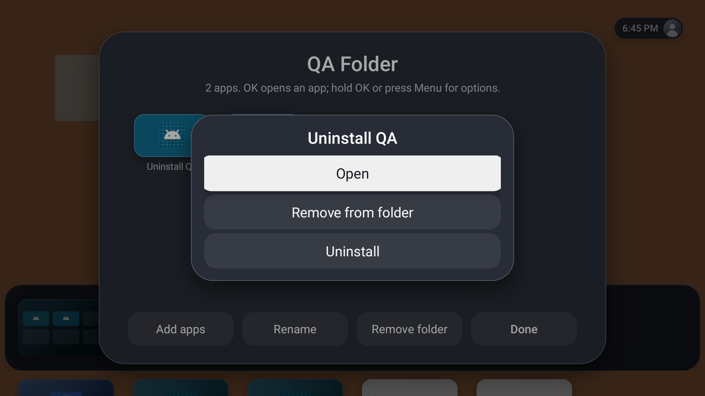 |

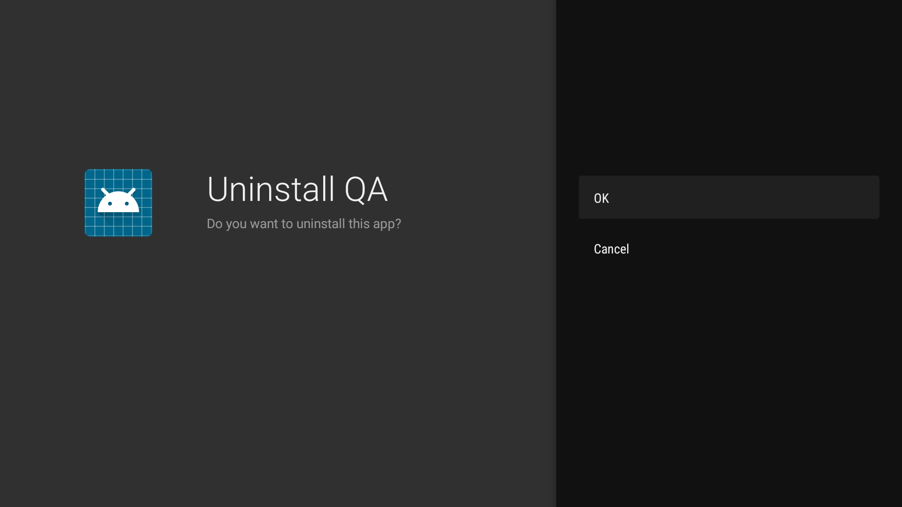

## Physical Fire TV

Fire TV Stick 4K Max (2nd generation, AFTKRT), Fire OS 8.1.8.5.

- Upgraded the signed build in place. The held-OK action opened Fire TV's native confirmation for a temporary local fixture; Cancel retained it, and confirmation removed it and refreshed Home.
- The active Launcher Manager Home handler had no Uninstall action. No existing user app was removed: the final installed-package list exactly matched the initial list after the fixture was removed.
- The launcher released its video-codec resources while the confirmation was open. Home returned to GlassOS and `OMX.MTK.VIDEO.DECODER.AVC` hardware aerial playback resumed.
- The disabled-package list, all five Amazon privacy values (`0`), native Home handler and 20-clip library matched the pre-upgrade audit. Usage access remained allowed and Most used stayed selected.

## Limits

Fire OS 5/6/7, other physical models, device-admin restrictions and a missing/blocked system uninstaller were not exercised. minSdk 22 is retained. Reboot and fresh Home setup were not retested. Earlier feature validation follows.

---

# Earlier release: 1.2.0-aerial.1

Validated on October 24, 2026. Package `io.github.abhishekkaisar.glassos.aerial`, version code 5.

## Automated checks

**57 JVM tests passed**, with no failures or errors. New coverage checks usage ranking, stable ties, missing/irrelevant history, folder totals and membership, overflow protection, layout reachability, and optional/strict backup preference handling. Debug and signed release builds passed. Lint: **0 errors, 113 warnings**.

## Remote UI on Android TV API 31

- Selecting Most used without Usage access showed the missing-permission message and kept the manual layout.
- After granting local Usage access, two emulator-only fixture apps were opened for controlled durations (6 and 14 seconds). The longer-used app ranked ahead of the shorter-used one; the six highest-ranked items occupied the top row and the remaining item stayed in the drawer.
- Switching to Manual restored the original dock and drawer order. Switching back restored the automatic ranking. Saved dock/order/folder/hidden preferences remained unchanged.
- A real held OK event opened the automatic-mode context menu. Adding an app to a folder edited the underlying manual dock rather than overwriting it with the ranked six-item row.
- Opening the sorted folder picker and saving unchanged membership preserved all manual member ordering and settings.
- The App order dialog and Home layouts were visually inspected at 1920×1080. Neutral synthetic videos and labelled fixture apps are used here; no personal device history is published.

| Manual layout | Most-used layout |
| --- | --- |
| 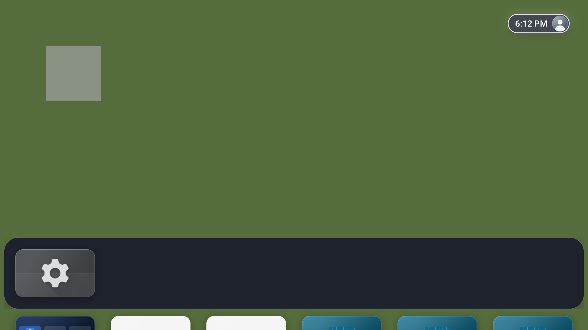 | 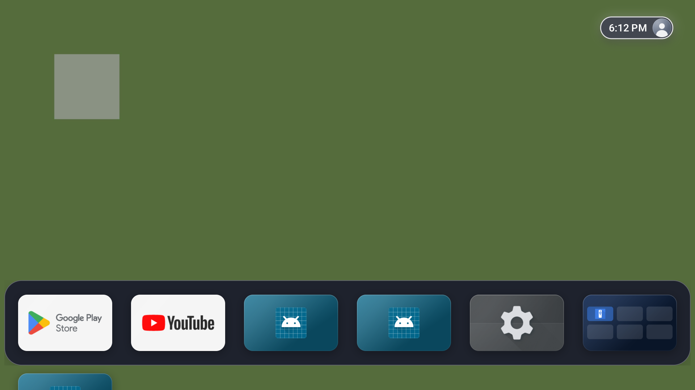 |

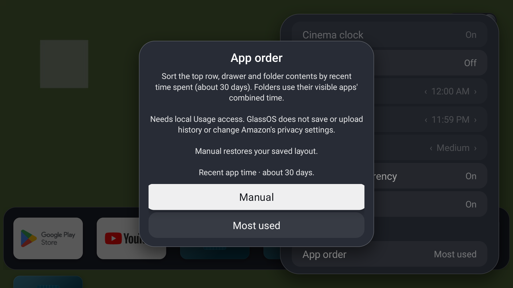

## Physical Fire TV

Fire TV Stick 4K Max (2nd generation, AFTKRT), Fire OS 8.1.8.5.

- Installed the signed version-code-5 release in place with the same signing certificate; its compiled TMDB key is empty.
- Granted only GlassOS Aerial's local Usage access and enabled Most used. Both the top row and drawer reflected existing foreground history; Ambient Experience and Launcher Manager no longer displaced viewing apps.
- The 20 local videos remained present. Home playback used `OMX.MTK.VIDEO.DECODER.AVC`; opening Fire TV Settings released the launcher's video-codec resources, and pressing Home restored hardware playback.
- All five recorded Amazon privacy values remained `0`, the disabled-package list matched the pre-upgrade snapshot, and Launcher Manager remained the native Home handler. No root, firmware, package-disable or routing changes were made for this release.

## Limits

The ranking uses Android's retained aggregate buckets, not an exact 30-day stopwatch. OS history and accounting can vary across devices. Fire OS 5/6/7, other physical models, fresh-device Home setup and reboot behavior were not retested for this release. Decoder checks sampled playback rather than watching all 20 clips. Earlier feature validation is recorded below.

---

# Earlier release: 1.1.0-aerial.1

Validated on October 24, 2026. Package `io.github.abhishekkaisar.glassos.aerial`, version code 4.

## Build and automated checks

- JDK 17, Android SDK/build tools 34.0.0.
- `testDebugUnitTest`: **49 tests, 0 failures, 0 errors**. Coverage includes scene naming/metadata/filtering,
  persistent shuffle and previous-history behavior, overnight schedules, folder layout, and strict backup validation
  and size limits.
- Debug and signed, optimized release builds succeeded. Lint: **0 errors, 113 warnings**.
- `ExpiredTargetSdkVersion` is the sole disabled lint check: this sideloaded launcher deliberately targets API 28
  for its existing shared-storage behavior. See the build file and README. Other warnings remain visible.
- The release APK contains no compiled TMDB key. Its signing certificate matches the preceding Aerial release,
  and an in-place upgrade retained the existing settings.

## Android TV emulator

Android TV API 31, ARM64, 1920×1080. Neutral, generated silent clips were used for these screenshots.

Remote-navigation checks covered the scenery browser and favourites; folder creation, opening, membership,
renaming and removal; night dimming; reduced transparency/motion; and backup export/import. A malformed backup
with duplicate folder membership was rejected with the original preferences byte-for-byte unchanged. A valid
backup restored the expected settings, and a shared-storage export excluded credentials and Home-routing state.

Cinema mode faded the launcher after the selected timeout. A held OK woke it without opening an app, and a later
intentional press worked. The final build also corrected and visually verified the four-button folder panel.

| Before: original Aerial home | After: new home/folder layout |
| --- | --- |
| 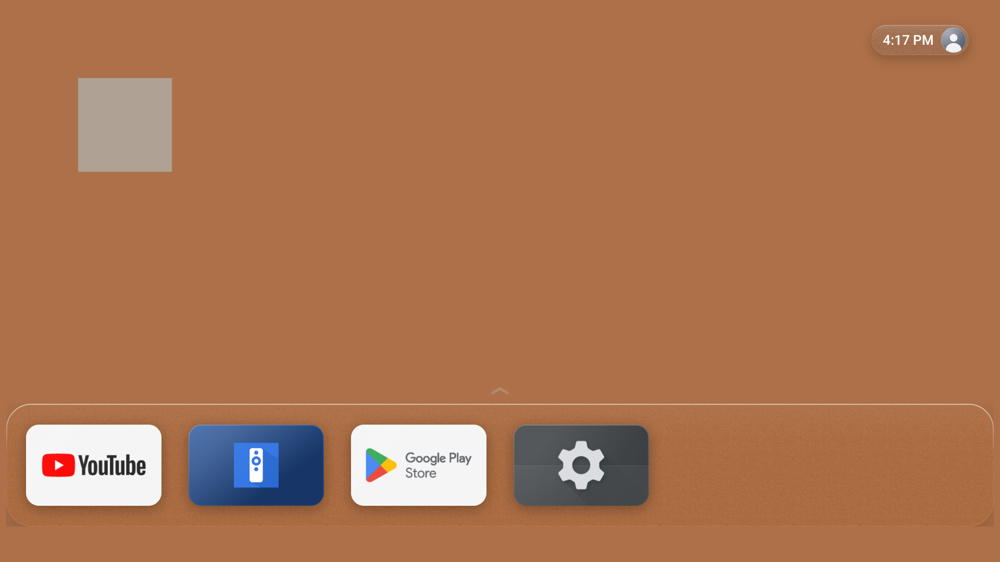 | 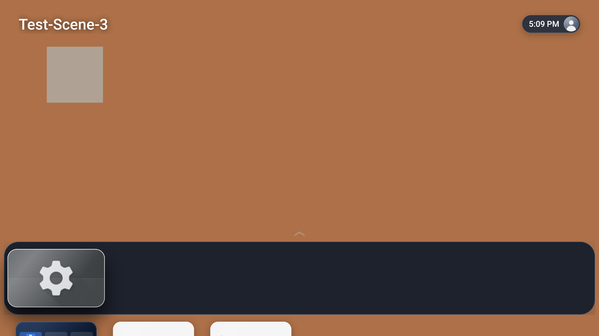 |

| Scenery browser | Cinema mode |
| --- | --- |
|  | 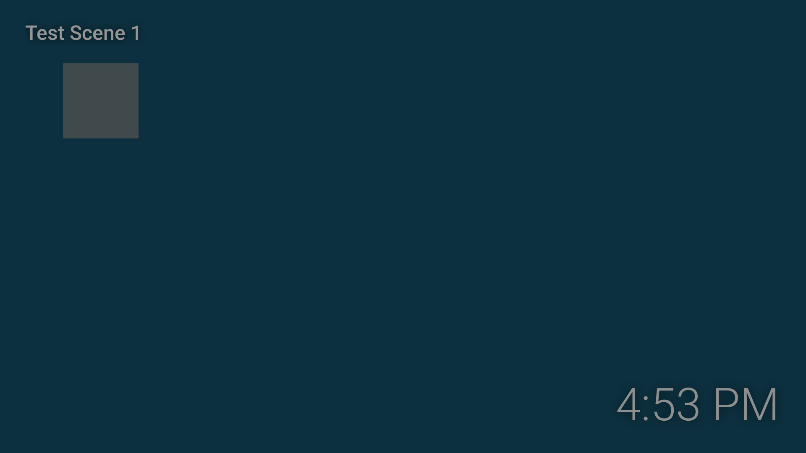 |

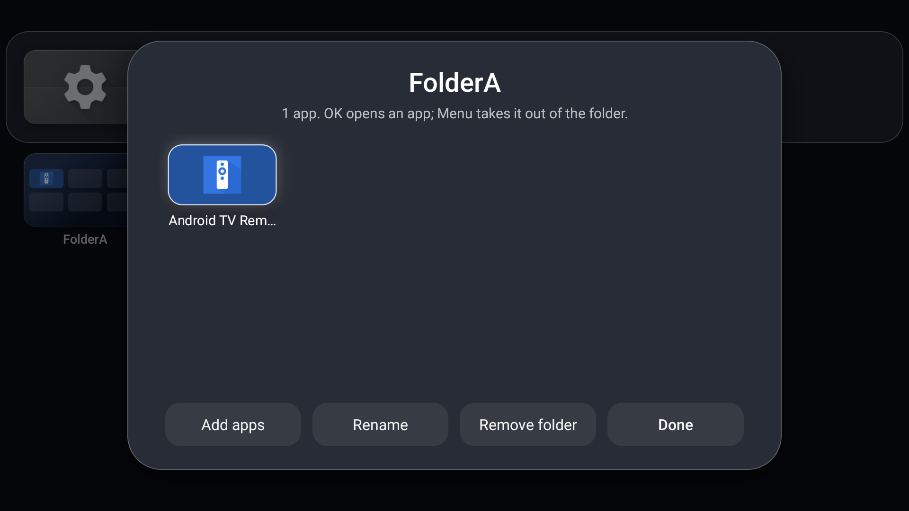

## Physical Fire TV

Fire TV Stick 4K Max (2nd generation, AFTKRT), Fire OS 8.1.8.5.

- Installed the signed release with `adb install -r`; retained the user's app layout and local library.
- Scenery browser detected **20 clips**. Sample playback used `OMX.MTK.VIDEO.DECODER.AVC` hardware decoding.
- Opening the standalone Fire TV Settings activity released the launcher's video-codec resources. Pressing Home
  returned to GlassOS Aerial and hardware playback resumed. The existing Launcher Manager Home handler remained
  selected.
- No system packages, firmware settings, privacy settings or Home-routing settings were changed for this upgrade.

## Limits

Fire OS 5/6/7, other physical models, fresh-device Home setup and reboot behavior were not retested for this
release. The previous Aerial version had reboot testing on this stick. This check was not a complete watch-through
of all 20 clips. Synthetic emulator media is not representative of every hardware codec or media file. The project
retains minSdk 22; support for older devices still needs physical testing.
