# Screen Mirroring (unreleased) validation

Validated on October 26, 2026 on the Android TV API 31 emulator (ARM64, 1920 × 1080), on top of 1.6.0-aerial.1, debug build. No iPhone, iPad or Mac was connected: mirrored video came from a debug-only feed that plays an MP4 through the receiver's own native callbacks, and pairing and discovery were driven by scripted RTSP requests over `adb forward` and `tools/airplay/probe.py`. **Not yet installed on a physical Fire TV.**

## Automated checks

**178 JVM tests (136 app, 42 receiver) and 97 Python tests passed** after a clean build, with no failures or errors. Lint reported **0 errors**, 131 warnings for the app (the 12 new ones are hard-coded UI strings, as elsewhere in Settings) and 4 for the receiver. `tools/airplay/check_apk.py` passed: both ABIs, 25 JNI exports each matching `NativeBridge.kt`, OpenSSL linked statically, 16 KB alignment, and the licence notices identical to the copy in the APK. `tools/airplay/vendor.sh --verify` found no difference in the vendored sources and patches. The release build (R8) passed the same APK check at 4,690,533 bytes; signed with the debug key for the emulator, it started the receiver, answered `probe.py`, showed a code request and refused wrong and malformed pairing keys. New JVM tests cover the status labels and when the receiver starts, stop-then-start ordering, aspect fit, the receiver screen's states, backups with and without Screen Mirroring, and the licence list; new Python tests cover the manager's read-only Screen Mirroring check.

## Settings, Control Center and About

| Before: Control Center | After: Screen Mirroring tile |
| --- | --- |
| 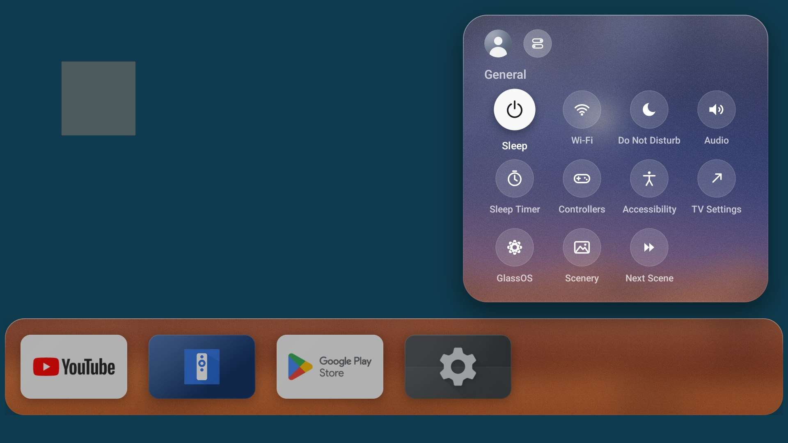 |  |

| Before: Settings | After: Screen Mirroring section |
| --- | --- |
| 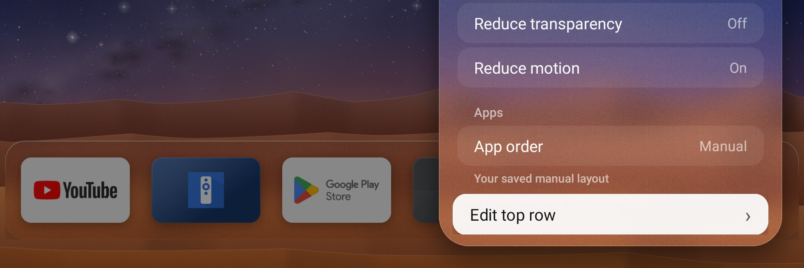 |  |

- **Mirroring** in Settings and the Control Center tile turned the receiver on and off; Status moved live through Starting, Ready as "name", Could not start, and back to Off. Turning it off and on again at once (gaps of 0, 35, 150, 400 and 1200 ms) always ended running, with no crash restarts counted.
- **TV name**, **Require PIN** and **Resolution** restarted the receiver in the same process, and `probe.py` then reported the new name; **Sender controls TV volume** applied without a restart.
- It started after a reboot and after `adb install -r` when it was on, before GlassOS was opened, and not from the locked-boot broadcast.
- With Screen Mirroring off, the home, scenery, Settings, Control Center and the held-OK menu worked as before, and no receiver process ran. A build without the receiver (`-Pglassos.airplay.native=false`) showed no tile, section or components line, even with Screen Mirroring left on in its settings.
- Backups carried the five Screen Mirroring settings and no keys or receiver files; restoring one that turns it on says so in the confirmation, including whether a code is needed. A build without the receiver neither writes nor restores them.
- **About** names the components and Apple's trademarks; **Open-source licences** listed every licence file in the APK and opened each in a D-pad reader. The Mac manager's **Screen Mirroring** panel read the state without a code, port or process number.

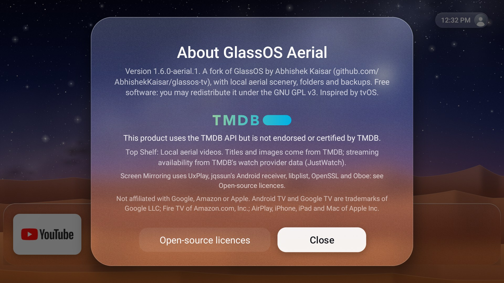

## The receiver screen

| Mirrored video with the Disconnect bar | Code request (debug code 1234) |
| --- | --- |
| 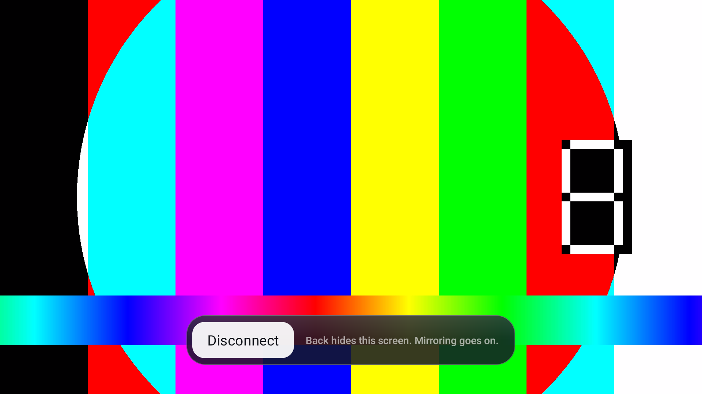 | 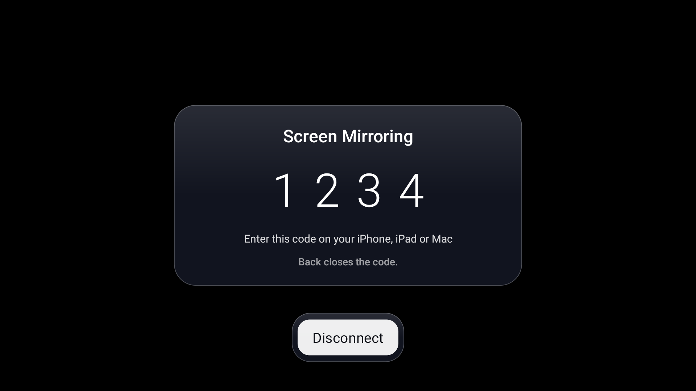 |

- 16:9, portrait and 2.4:1 clips were drawn sized to fit, matching the expected frame to the pixel.
- When mirroring started, the scenery player released its decoder before the first mirrored frame was decoded (300–440 ms earlier, including the feed's 200 ms setup gap), and the scenery resumed where it stopped after the session, screensaver included. The screensaver showed no scenery while a hidden session ran.
- Back hid the screen while frames kept decoding; the tile, reading **Mirroring**, brought it back. Disconnect and the remote's Stop key ended the session. With another launcher in front, the screen was not forced open: the session ran hidden until GlassOS was in front and the tile was chosen.
- A real code request from a scripted sender showed a random code on the TV only: not in the notification, any log or any reply. Wrong codes, sent the way a real sender sends them, were refused with waits of 1, 2, 4 and 8 seconds, and after three the TV showed a new code. Malformed pairing keys (too long, zero, or empty) were refused and the receiver kept running, with Require PIN on or off.
- Debug StrictMode logged no violations in the receiver process, and no ANR occurred. A crash of the receiver process released the scenery and the receiver was restarted.

## Fixed during testing

Three code reviews (correctness, security and privacy, design and wording) found 18 distinct problems, and the recheck of their fixes found one more in UxPlay. Each was fixed and rechecked on the emulator, except two: the source bundle was checked in a throwaway git repository on the Mac, and one part of the code-guessing finding (tying the code request to the same connection) was left because it needs a real sender to test:

- **The scenery could open its decoder while the mirror's was still running (medium).** Stopping or restarting the receiver now releases the mirror's decoder before the home hears about it.
- **Any device on the network could stop the receiver (high, in UxPlay's pairing code).** A malformed pairing key crashed the receiver process, with or without Require PIN; three in a row made GlassOS give up restarting it. A new UxPlay patch, 0012, refuses the key instead.
- **Codes could be guessed (medium).** UxPlay patch 0011 adds the growing wait, the new code after three wrong ones, and keeps the pairing steps in order. The code is no longer written into the notification.
- **The GPL source bundle could include stray private files (medium).** `make_source_bundle.sh` now packs tracked files only unless `--include-untracked` is given, and it lists each file that option adds.
- **A receiver left running while Screen Mirroring is off is now stopped**, and one that is wanted survives a launcher restart. After a restart during mirroring, the old session's late messages no longer reach the new one.
- **Design and wording:** the Over other apps row only appears on Android 10 and later; the status row stays visible when Mirroring is chosen; the focused Disconnect button is no longer clipped; Back from a licence keeps its place in the list; plain-text licences reflow to the screen; the About text, the Permissions step, the guide and the Mac manager's wording were corrected.

The first pass also found the receiver reading from disk on its main thread when it started; the native library now loads and runs on its own worker thread.

## Limits

Only the Android TV API 31 emulator was used, with simulated senders. Not tested: a real iPhone, iPad or Mac (discovery, pairing, H.265, audio), the **Playing** state and Now Playing panel (no audio-only sender), Fire TV hardware and Fire OS, the Home overlay used with Replace Fire TV home, and Android 7.0 or earlier, where the feature hides (covered by JVM tests). Video handed over from apps (HLS) and Apple Lossless audio are not supported. The emulator cannot be reached by Bonjour from the Mac, so no Mac-to-emulator session was attempted. GitHub Actions was not run.

---

# GlassOS Aerial 1.6.0-aerial.1 validation

Validated on October 25 and 26, 2026 on the Android TV API 31 emulator (ARM64, 1920 × 1080). Package `io.github.abhishekkaisar.glassos.aerial`, version code 9, debug build. **Not yet installed on a physical Fire TV.**

## Automated checks

**117 JVM tests and 91 Python tests passed**, with no failures or errors. The debug build passed, lint reported **0 errors, 119 warnings** and `node --check` passed for the manager's script. New JVM tests cover code buttons, salted hashing, damaged stored codes, the 5-try wait, unlock sessions, which foreground events count as a screensaver (a locked app never does), sun times on reference days including DST changes and polar days, time-zone places, sun-anchored schedules and night windows, where the scene name sits beside the cinema clock, and the day change that refreshes an open Settings panel. New Python tests cover the manager's lock, sun and screensaver controls, the internet-address lookup with a mocked reply, and a slow TV reported as slow without the command line.

## App lock on Android TV API 31

The emulator's existing 1.5.0 install was upgraded in place with `adb install -r`; its layout, folders and scenery settings were kept.

| Before: held-OK menu (1.5.0) | After: Lock app |
| --- | --- |
|  | 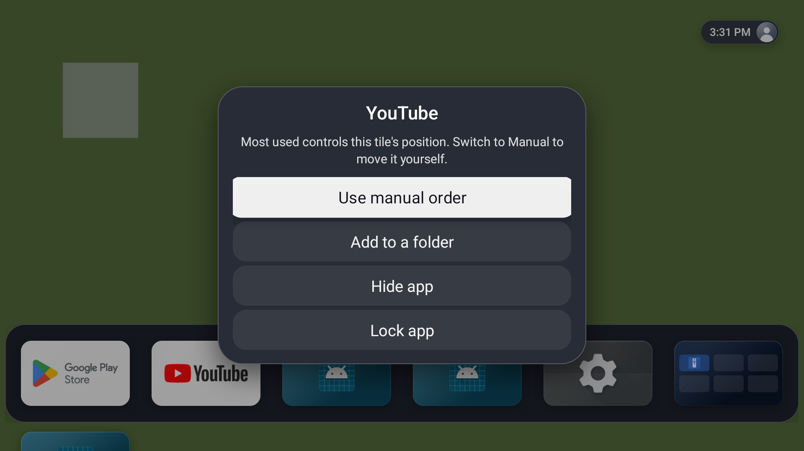 |

| Choosing the code | Opening a locked app |
| --- | --- |
| 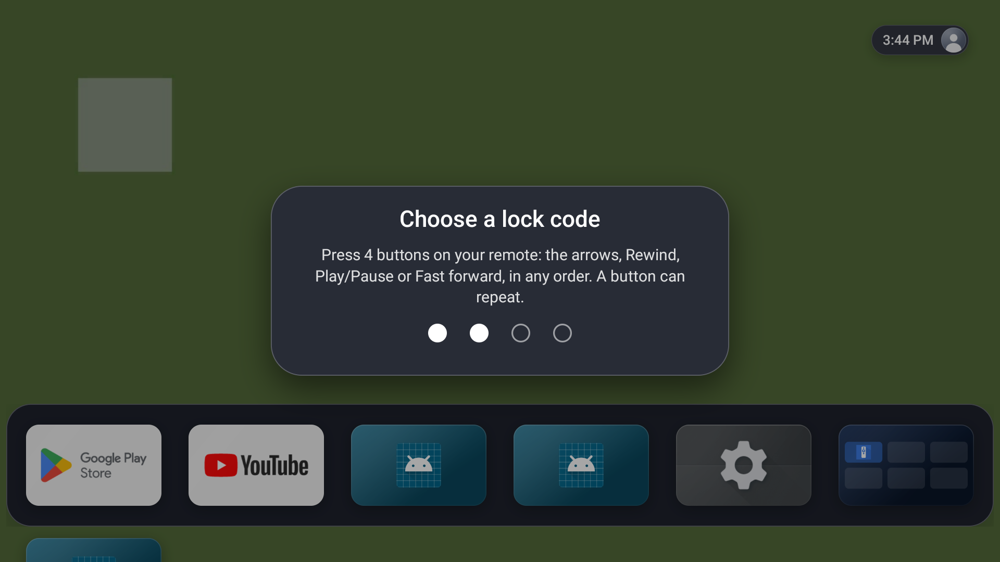 |  |

- **Locking:** the first Lock app asked for a code twice. Different entries saved nothing; Back cancelled without saving. The stored value was a 97-character salt and hash. The tile showed a padlock, also inside a folder, where held OK offered Lock app.
- **From GlassOS:** OK on the locked tile asked for the code. A wrong code shook and cleared the entry; the right one opened YouTube. Unlock app needed the code.
- **Without Display over other apps,** locking explained that only GlassOS launches were covered and offered Permissions.
- **However it opens:** with Usage access and Display over other apps, the guard ran while an app was locked. YouTube started from the shell, standing in for a cast or Alexa, was covered. The guard logged the cover 2 ms after YouTube was displayed; the lock screen itself took 1.07 s to display on this emulator.

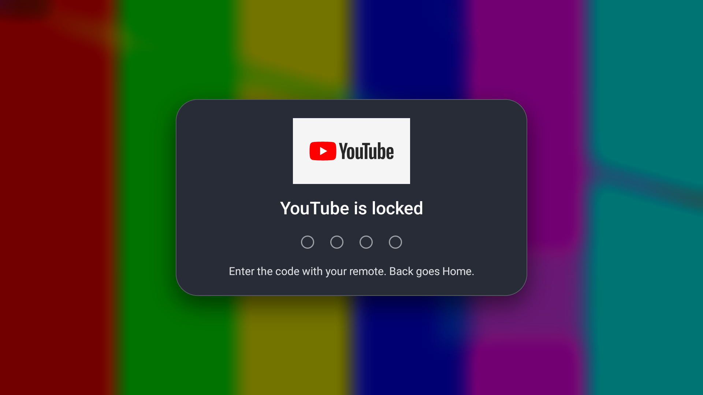

- The right code returned to YouTube. Starting it again while it was open was not covered. After Home, starting it again was covered; Back from the lock screen went Home.
- Unlocking from the tile kept the guard from covering the app it opened.
- Five wrong codes paused entry for 30 seconds; the right code was refused during the wait and accepted after it.
- Sleep then wake covered the open, unlocked app again.
- **A screensaver does not end an unlock.** With YouTube opened from its tile, a screensaver (Backdrop or GlassOS scenery) started over it with `service call dreams 1` or Android's start-screensaver shortcut, then a key to wake, left YouTube open without the code. The shortcut path locked it again until a fix made during testing (below).
- **Casting protection** is the manager's name for this cover. With Display over other apps withdrawn, the manager reported it off and offered to allow it again (see TV controls from the Mac).
- After a reboot, the guard started from the boot receiver and covered YouTube.
- **Settings > App lock** showed the count. With the code, Turn off app lock cleared the list and code and stopped the guard.
- A fresh settings backup contained no lock fields.

## GlassOS scenery screensaver

Generated test clips, with Scene names, Cinema clock and Move cinema clock on. The TV's screensaver was pointed at GlassOS by hand over ADB and from the manager.

| Before: Scenery and display (1.5.0) | After: Screensaver and Night follows rows |
| --- | --- |
| 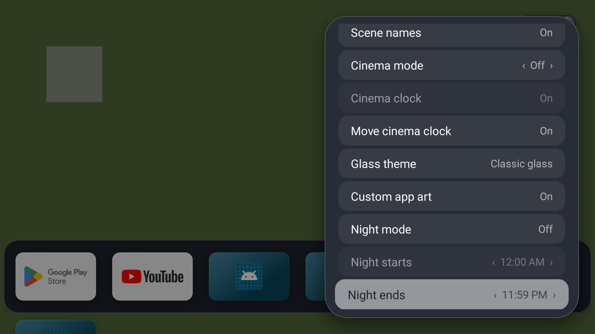 | 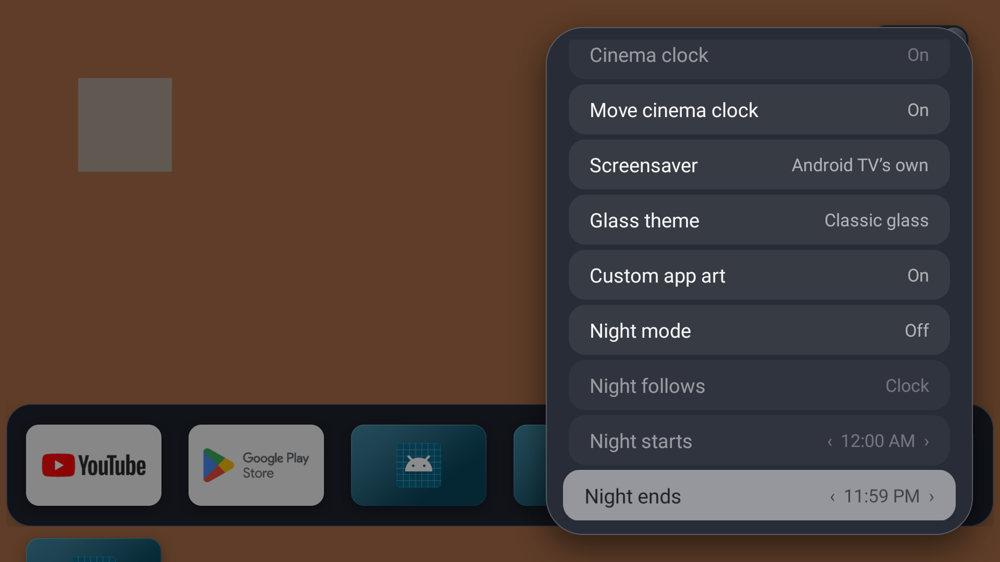 |

- **Discovery:** Android listed GlassOS's screensaver beside the emulator's own two (`cmd package query-services`).
- **Settings > Screensaver** read "Android TV’s own" until the TV's setting pointed at GlassOS, then "GlassOS scenery". A panel already open keeps the old value until it is reopened. The card explains how to turn it on (with no restart sentence on Android TV), or that the scenery plays when the TV is idle in any app; both offer Preview. The control channel's status reported the screensaver as active only while GlassOS was chosen.

| Screensaver card | Chosen as the TV's screensaver |
| --- | --- |
| 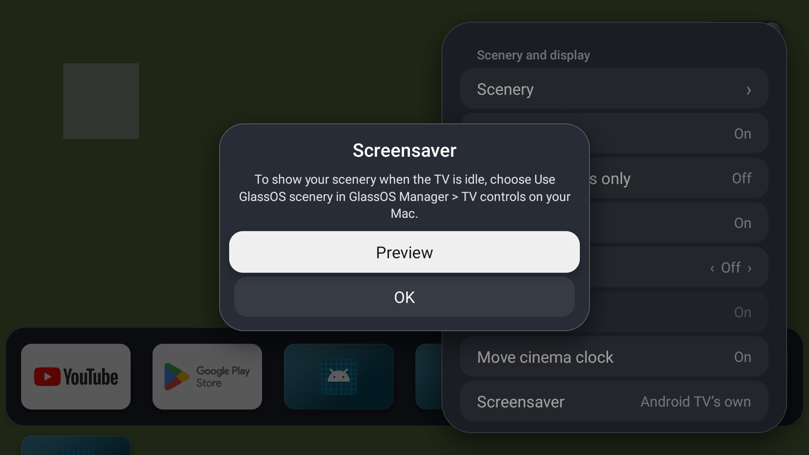 | 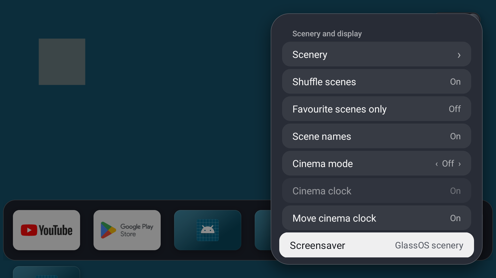 |

- **Decoder handoff:** at every start the home released its decoder before the screensaver played the same clip from the same position. Over 5 screensaver and wake cycles the order held both ways, `dumpsys media.player` showed one player, and the home played again after every wake.
- A 3-minute run with about 20 clip changes skipped no clip. Before that, one clip was skipped once after an error in the emulator's H.264 decoder under heavy host load.
- **Night dimming** matched the home: the same dim factor (about 0.58), with the scene name and clock dimmed too.
- **Without storage access** the screensaver showed the fallback background with the cinema clock. It was still running after 100 s, with the clock moved. After access was granted again, the home played without a restart.
- **Preview** from the card played from the home's position with one player; a key ended it and returned to Settings. It ran inside GlassOS's task, with no recent entry of its own. `am start` from the shell was refused, because the preview is not exported.
- **Scene name and clock:** after a fix made during testing, the name sat bottom left while the clock was top left and was gone in the frame the clock moved into its corner, checked frame by frame in a 118 s recording. The grey square below is part of the generated clip.

- **From the Mac:** Check only read the settings, and said that Stay awake while plugged in stops any screensaver and that this TV may sleep first. **Use GlassOS scenery** listed the three settings it changes and offered to turn off Stay awake. The TV read back exactly those values, with every other value unchanged, and the Mac saved the originals. A second Use kept the first saved values. **Restore previous screensaver** put all 10 tracked values back. The TV was never restarted.

| Check | Use GlassOS scenery |
| --- | --- |
| 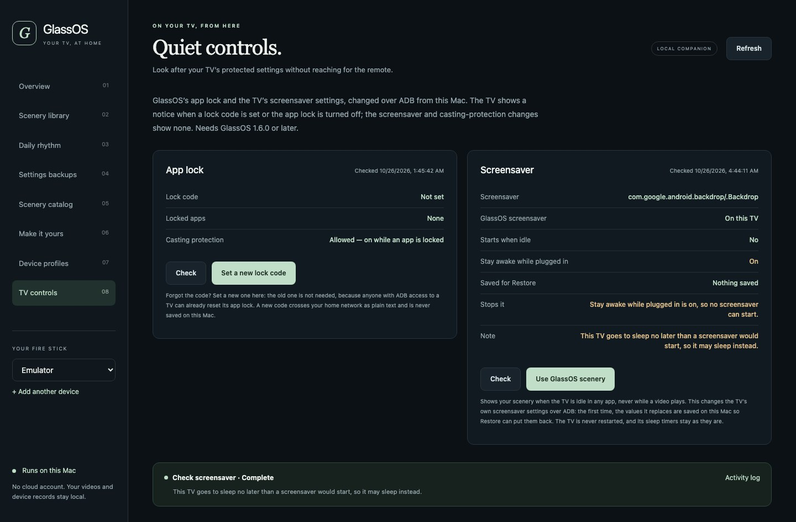 | 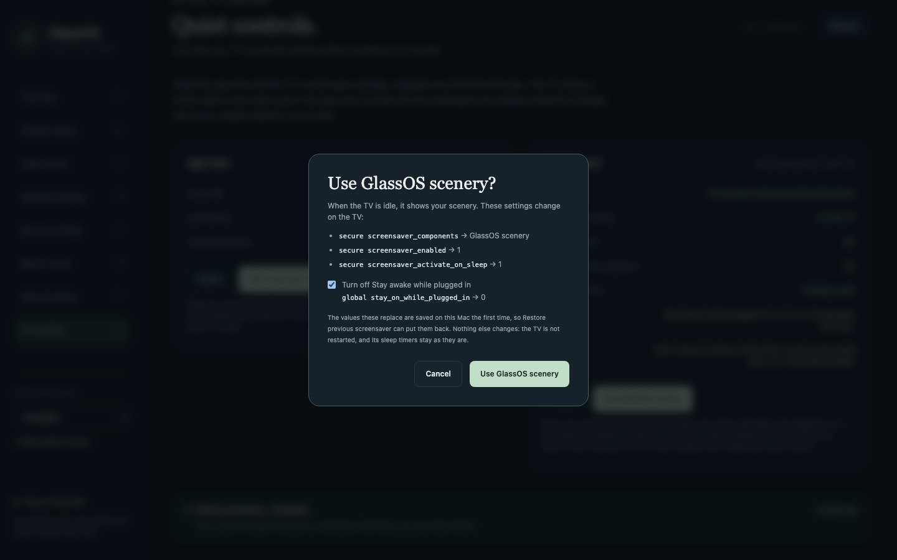 |

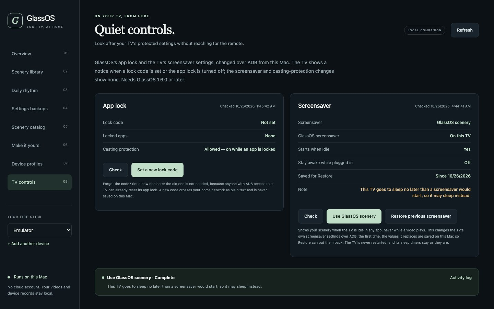

## Sun times and Night mode

The emulator's time zone was America/Los_Angeles. Every place set was a test place.

| Before: Night rows (1.5.0) | After: Night follows and Sun times |
| --- | --- |
| 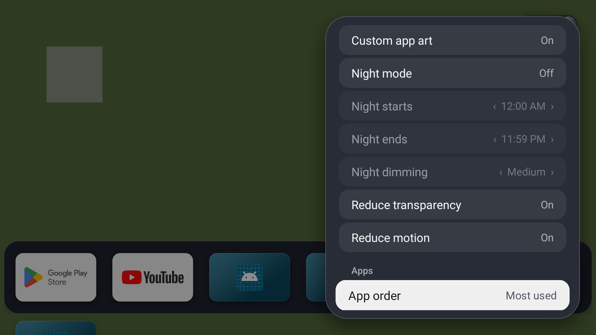 | 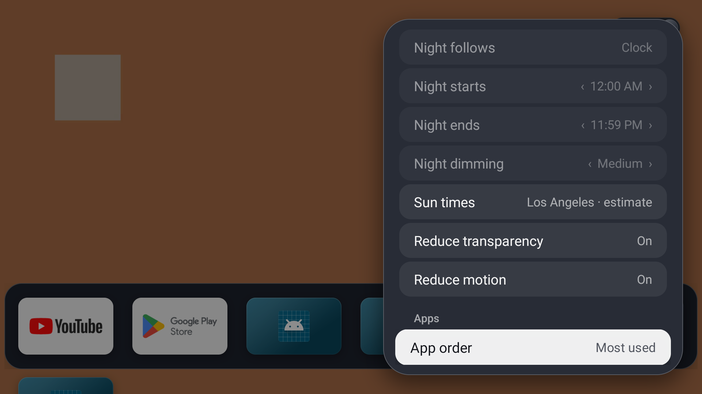 |

- **Time-zone estimate:** status reported Los Angeles, with sunrise 07:07 and sunset 18:06 on October 26, the same as the manager's own calculation.
- **Place set from the Mac's control channel:** the TV showed a notice and the open Sun times row changed to "‹place› · from Mac" without leaving Settings. A label with an apostrophe and a comma came through intact. Latitude 91, longitude 181, NaN, a missing field and text were refused with "That is not a place on Earth.", and the saved place was kept. Clearing it returned the row to "Los Angeles · estimate" and left no saved place.
- **Settings > Sun times** card: today's times in the 12- and 24-hour formats, and where they come from. OK closed it.

- **Sunset & sunrise:** Left and Right moved Night starts and Night ends 15 minutes at a time and stopped at ±120.
- **Fallbacks:** at test places 77° N and 75° S, offsets that left no day or no night used the clock times, shown as "uses …". One 15-minute step back followed the sun again, at the computed boundary. This emulator's clock window is 12:00 AM to 11:59 PM, hence "uses 12:00 AM". The longest values fit on one line.

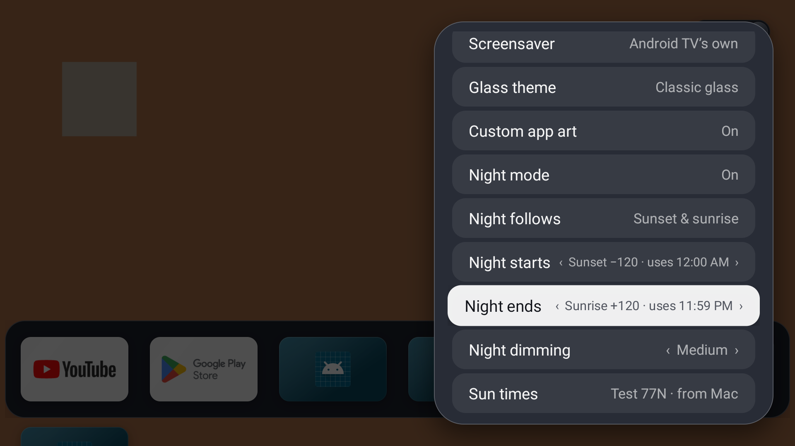

- **Minute tick:** with a test place whose sunset +120 fell a few minutes ahead, the dim layer came on at that minute's tick. Back on Clock, the clock window applied at once.
- **No place for the zone:** with the zone switched to UTC (no reboot), status reported no source, the card said sun times are unavailable, Sun times read "Unavailable" and the Night rows used their clock times. After a fix made during testing, an open panel follows the change.

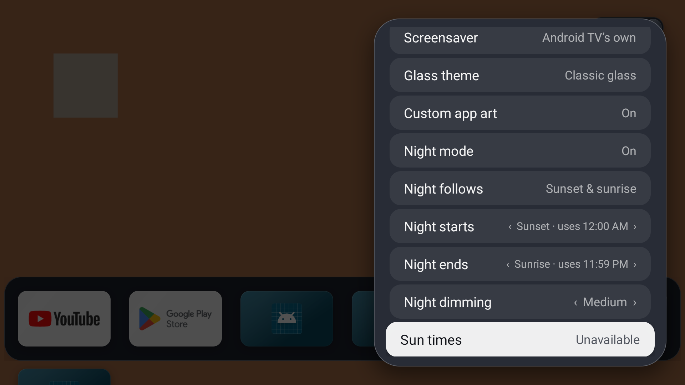

- **Daily rhythm on the TV:** with a test `scenery.json` holding a sunrise entry and a sunset entry, Scheduled played the sunset entry's collection, where the fixed starts alone would have picked the sunrise one. With a test place whose sunrise was 02:53, the clip changed at 02:53:00.
- **Daily rhythm from the Mac:** an entry starts at a time, sunrise or sunset, with an offset and a preview of today's time. Saving gave each sun entry a fixed start for the time zone's main city (6:37 AM for sunrise −30, 6:36 PM for sunset +30), not for the place saved on the Mac. Sync sent `scenery.json` with the anchors and no coordinates or place name.

| Before: Daily rhythm (1.4.0) | After: entries can start at sunrise or sunset |
| --- | --- |
|  |  |

- **Sun times location panel:** Check read a place set elsewhere, Save to TV sent one and Use time zone estimate cleared it. Those buttons and the lookup were disabled while a job ran. **Look up from internet address** is present and was tested only with a mocked ipinfo.io reply; no live lookup was made, and Use this Mac's location was not used.
- The Scenery collection card now says entries can follow sunrise or sunset.

## TV controls from the Mac

GlassOS Manager ran with a scratch data folder, with the emulator added over loopback ADB. The page was driven in headless Chromium at 1440 px.

- **Check** read the lock state over the ADB-only control channel: code set, 1 app locked, casting protection on. Under heavy host load the first Check timed out (fixed below); the retry passed.
- **Set a new lock code** asks for the code twice. Different entries said nothing was sent; no job ran and the TV's code was unchanged. A matching code reached the TV, which showed a notice; the old code was then refused and the new one opened YouTube. Buttons and the keyboard's arrow keys both entered codes.
- **Casting protection:** with Display over other apps withdrawn, the panel showed it off and offered **Allow casting protection**. Its confirmation names the one `appops` command; afterwards the permission read back as allowed.
- **Turn off app lock** cleared the code and the locked list. The TV showed a notice and removed the padlock. It also closed a lock screen that was showing, one left from before the TV slept, and the home's code prompt; an open Settings panel changed to Off.
- **The code is never kept:** no test code appeared in the manager's data folder, its state, job log or output, the browser's storage, any reply from the TV, logcat or GlassOS's own log.
- Bad codes and unknown requests were refused with no change. With GlassOS force-stopped, status and a new code still worked; the notice then appeared about 3 s later.

| Check | Casting protection off |
| --- | --- |
|  | 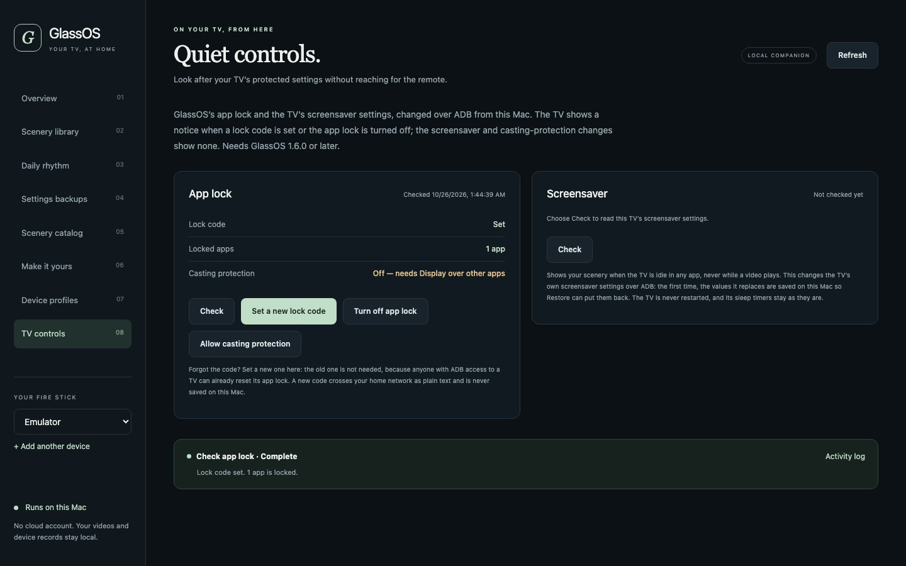 |

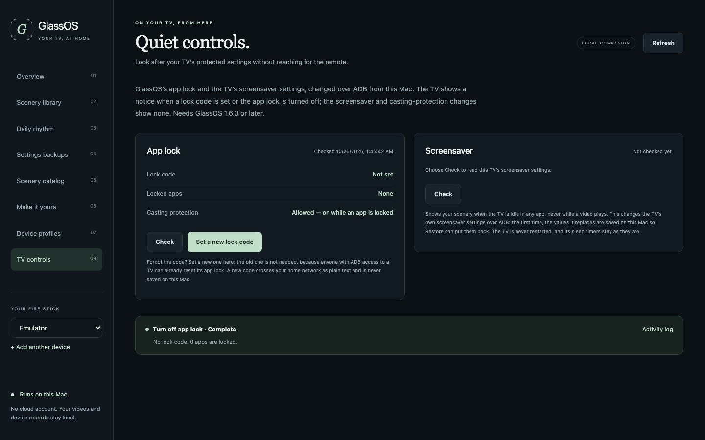

## Fixed during testing

The first emulator pass found seven problems. Each was fixed, then checked on the emulator with the new build unless stated.

- **The start-screensaver shortcut ended an unlock (medium).** Android's shortcut comes to the front briefly before a screensaver, and the guard took it for another app. The guard now also skips it, and the TV's chosen screensaver package when that package has no launcher entry; a locked app never counts. With Backdrop and with GlassOS scenery, the shortcut and `service call dreams 1` both left YouTube open after waking. Sleep then wake, Home then an outside launch, and an outside launch with no unlock were still covered. The rule for the chosen screensaver's package, and its answer being refreshed when packages change, were checked with a stand-in package. The same fix counts Fire TV's Ambient Experience as a screensaver; that has a JVM test only.
- **Scrolled options covered the Scenery collection title and message (medium, older than 1.6.0).** Card lists now clip to their own area. The title and message stayed readable at all 19 focus steps down to Scheduled and back. Menu cards also cut the focused row's zoom and rounded corners flat; they now show in full, checked on the collection card, the held-OK menu and a folder menu.

| Before: focused row cut flat | After |
| --- | --- |
|  |  |

| Before: collection card (1.4.0) | After: new text, scrolled to Scheduled |
| --- | --- |
|  | 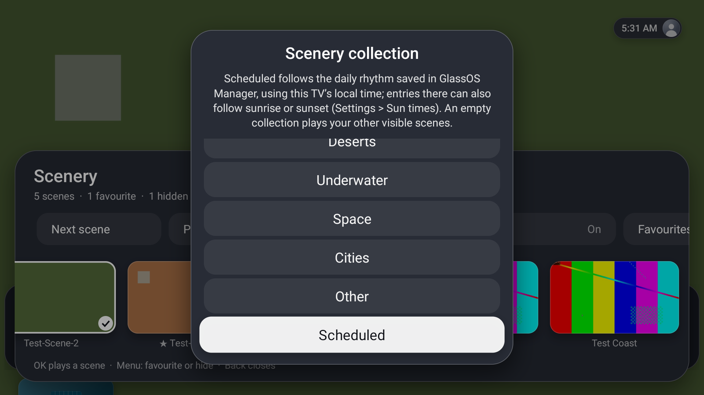 |

- **The scene name covered the cinema clock (low).** The name now sits bottom left while the moving clock is top left, and hides at once if the clock moves into its corner; the Top Shelf's hint moves to the clear corner instead. Checked in the screensaver frame by frame, and in home cinema mode at 1080p, including leaving cinema with the Top Shelf focused.
- **An open Settings panel ignored a time-zone change (low).** Switching to UTC and back updated Sun times and both Night rows within 4 s, and a 24-hour change showed at the next minute tick, without rebuilding the panel or moving focus. The midnight rollover was not driven; a unit test covers it.
- **The Sun times row cut its source (low).** "· from Mac" or "· estimate" now always shows: a long value drops to 15sp, then only the place name is shortened. Short values keep 17sp, and the longest Night values still fit.

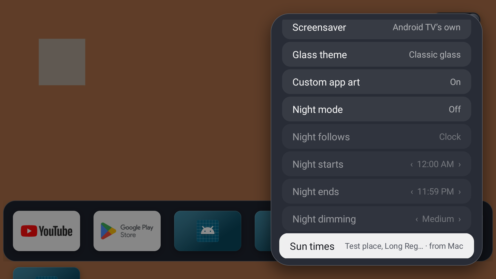

- **The manager called a slow TV outdated (low).** A timed-out call now says "The TV took too long to answer; it may be busy. Wait a moment, then try again.", with no update hint and no command line. Checked by unit tests and with a forced 0.05 s timeout against the emulator.
- **The manager's "Daily rhythm saved" note vanished after about 1 s (low, older than 1.6.0).** It now stays until a newer job starts or reports progress; it held for 15.7 s. A job past 100 messages was checked only with synthetic data.

Two brief overlaps remain (low, home cinema mode only): entering cinema can fade a scene name out over the clock for up to 0.6 s when the moving clock starts top left (found by code review), and leaving cinema with the Top Shelf focused draws its hint over the fading clock for about 0.2 s (seen on the emulator).

## Limits

Only the Android TV API 31 emulator was used: no physical Fire TV, no Fire OS version and no other Android version. These results are for the debug build; no signed release was built for this record, and GitHub Actions was not run.

**App lock.** Not tested: a real phone cast, Alexa, Fire TV remote app buttons and recent apps. On a Fire TV, starts held after the Home key (about 5 s) and the time to display the lock screen still need measuring. Also untested: the Top Shelf deep-link path (it needs TMDB titles), the Move-mode menu and the Home overlay used with Replace Fire TV home. As documented in the [user guide](USAGE.md#app-lock), this is a launcher lock: force-stopping or clearing GlassOS from the TV's Settings turns the guard off until GlassOS opens again.

**Screensaver.** The Fire OS path is untested: whether Fire OS keeps a third-party screensaver, Amazon's Ambient Experience, and the app lock's Fire TV screensaver rules. The guard counts Ambient Experience in front as a screensaver even when it was opened on purpose. On API 31 the screensaver runs as `DreamActivity` and pauses the home, so the API 22–29 window path, where the home stays resumed, was not exercised. The idle timeout was never reached (the emulator stays awake while plugged in): screensavers were started with `service call dreams 1`, the call the idle path makes, and with Android's start-screensaver shortcut. That the Top Shelf does not rotate while the screensaver holds the decoder was checked by reading the code only; the other Top Shelf sources need the network.

**Sun times.** No live internet-address lookup was made and the Mac's location was not used. Sync of sun entries used one 9-second test clip.

**Test conditions.** The host was heavily loaded. The emulator's system_server restarted once, and the emulator crashed once and was cold-booted without a window, keeping its data; neither came from GlassOS. The manager was driven in Playwright's headless Chromium, which drew Rewind and Fast forward in the code dialog as colour emoji; desktop Chrome draws them as text.

---

# GlassOS Aerial 1.5.0-aerial.1 validation

Validated on October 24, 2026. Package `io.github.abhishekkaisar.glassos.aerial`, version code 8.

## Automated checks

**66 JVM tests and 36 Python tests passed.** Debug and signed optimized release builds passed; lint reported **0 errors, 115 warnings**. JavaScript syntax passed. New tests cover backwards-compatible appearance backups, strict theme/boolean validation, clock positions, feed shape/size limits, SDR preference and deduplication, unsafe URL/private-address rejection, interrupted-download cleanup, failed-feed preservation, icon filename traversal and health diffs.

## Catalog, personalization and profiles

The browser loaded the live Aerial Community feed (20 supported entries), searched for Bixby Creek Bridge, assigned Coastlines and downloaded/compressed the selected source. The source was shorter than the requested 90-second maximum: output was 54.87 seconds, silent H.264, with a poster; total 22,891,838 bytes. Verified sync copied the two new files and skipped all 40 existing videos/posters. There are now 21 clips on the tested stick. Third-party video files remain private and are not included in this repository or release.

On Android TV API 31, remote Left/Right changed glass themes immediately; the custom-art switch preserved original icons. The browser file picker imported a neutral PNG, and manager sync updated real fixture app tiles without restarting GlassOS. A damaged PNG fell back to the app's original resources; Restore original removed only the chosen manager-owned image. A fresh settings export included the theme, custom-art switch and clock movement. JVM checks verify these preferences round-trip and older backups leave them unspecified.

Cinema mode was allowed to enter naturally. On a real minute tick, the clock moved from bottom left (`[64,887][513,1032]`) to top left (`[64,48][513,193]`) within the 1920 × 1080 screen. The first OK woke Home without opening an app. These are discrete moves, not continuous animation or a burn-in guarantee.

The physical device baseline recorded the old version, model/ABI/RAM, firmware, native Home handler, privacy values and blocker identity. After the upgrade, the comparison correctly reported only the GlassOS version change; free storage was reported separately. The baseline remains the pre-upgrade state. No firmware, root, Home-route, privacy or permission changes were applied.

| Before: Classic glass | After: Forest palette |
| --- | --- |
|  |  |

| Cinema clock before minute tick | After minute tick |
| --- | --- |
|  |  |

## Physical Fire TV lifecycle and upgrade

Fire TV Stick 4K Max (2nd generation, AFTKRT), Fire OS 8.1.8.5 / RS8185.3891N. The manager saved the previous APK and a fresh settings backup, verified the certificate and target APK hash, and installed with `adb install -r`. A fresh post-upgrade backup matched the original layout, folders, scenery and existing display values exactly. Only the new default appearance fields were added. All five recorded privacy values remained off, four tracked packages remained disabled and the three Instagram blockers still matched their saved APK hashes.

**10 Home/Settings cycles and sleep/wake passed.** The media player was released while away and resumed on return; per-cycle app PSS ranged from 87,707 to 97,063 KB. These short samples do not establish overnight stability or account for all decoder/GPU memory.

## Before/after performance on the same physical stick

Five samples per release, five-second settling periods, the same existing 20-clip library and display preferences; the new clip was synced afterward. The initial run while the TV was dozing was discarded. The reusable [benchmark tool](../tools/benchmark_launchers.py) now refuses to measure a sleeping device. No Home routing or app data is changed.

| Median | 1.4.0-aerial.1 | 1.5.0-aerial.1 |
| --- | ---: | ---: |
| Cold activity `TotalTime` | 446 ms | 449 ms |
| Return from Settings `WaitTime` | 174 ms | 139 ms |
| App PSS | 111,430 KB | 110,804 KB |

These results show similar resource use in this short run, not a demonstrated speed improvement. `am start -W` reports Activity launch timing, not first usable video frame. Shared video decoder allocations can be attributed outside the app. Device state, caches and different selected clips introduce noise.

## Limits

Other physical models, Fire OS 5/6/7, reboot persistence and a fresh privileged Home setup were not retested. Custom imagery and malicious-file cases used the emulator, not personal apps or files. Feed providers can change URLs or remove media. The manager's profile checks recorded configuration rather than network traffic. The current signing key and compiled empty TMDB key are retained.

---

# GlassOS Aerial 1.4.0-aerial.1 validation

Validated on October 24, 2026. Package `io.github.abhishekkaisar.glassos.aerial`, version code 7.

## Build and automated checks

**63 JVM tests and 28 Python tests passed**, with no failures or errors. Debug and signed optimized release builds passed; lint reported **0 errors, 113 warnings**. JavaScript syntax and Python lint checks passed. The release retains the existing signing certificate and an empty compiled TMDB key.

New coverage includes collection selection and midnight-wrapping schedules, invalid schedule/backup input, playback progress timeouts, interrupted transfers and retries, failed remote hashes, corrupt local sources, low-space refusal, storage budgets, unchanged-file skipping, and metadata publication after successful transfers. Companion tests also cover authenticated API access, Host/Origin checks, traversal refusal, upload limits, serialized jobs, stale backup rejection and invalid APK identity rejection.

## Mac companion

The real browser UI was exercised against an Android TV API 31 emulator. A generated video with audio was uploaded through the file picker, encoded by FFmpeg, fully decoded for validation and inspected as silent H.264 with a JPEG poster. Collection filtering, title/category edits, daily schedule editing and persistence, checked sync, fresh backup export and restore handoff were exercised. Cancel on the TV preserved its settings; confirming Restore applied the copied backup. Final browser checks verified all 20 saved collection previews loaded after reopening and Refresh; preview requests are bounded and retry transient failures.

These captures use generated test videos and a neutral test-device name. Private addresses, tokens, device logs, backups and third-party video files are excluded from the repository.

## TV scenery and recovery

Android TV API 31 remote checks covered collection selection, Scheduled mode, changed schedule loading without a restart, metadata refresh while the browser was open, corrupt-clip skipping, decoder release with no available clips, and recovery after replacing a failed clip at the same filename. The original emulator library and preferences were restored after these controlled fixtures.

| Before: scenery controls | After: collection and refreshed metadata |
| --- | --- |
|  |  |

## Lifecycle and physical Fire TV

Fire TV Stick 4K Max (2nd generation, AFTKRT), Fire OS 8.1.8.5.

- The manager archived the previous APK and settings, installed the signed release in place and verified the installed APK hash. Layout, folders, display preferences, favourites and Most used mode were preserved. Collection mode remains All scenes unless Scheduled is selected on the TV.
- All 20 videos and 20 posters matched their existing hashes, so sync skipped recopying them and transferred only scene metadata and the daily schedule.
- **10 Home/Settings cycles plus sleep/wake passed on the physical stick; 12 cycles plus sleep/wake passed on the emulator.** The media service showed decoder release while away and active playback on return. No crash was observed.
- Physical per-cycle PSS samples decreased from 104,234 KB to 101,267 KB. These are short-run samples, not proof that memory cannot grow during longer use.
- Four physical playback samples over one minute showed `OMX.MTK.VIDEO.DECODER.AVC`, muted playback and zero reported dropped frames. Pressing the native Home button from Settings returned to GlassOS.
- The installed-package list, disabled-package list, native Launcher Manager Home handler, five Amazon privacy values (all `0`) and three existing Instagram blocker APKs were preserved. Usage access remained allowed. No root, firmware, Home-routing or privacy changes were made for this release.

## Limits

Fire OS 5/6/7 and other physical models were not exercised; minSdk 22 is retained. Reboot and fresh Home setup were not retested. Interrupted transfer and low-storage behavior were tested with controlled subprocess fixtures, not by filling or disconnecting the physical stick. Missing/corrupt media tests used the emulator. Playback evidence samples a short run, not every complete clip or an overnight soak. The manager does not delete existing extra videos, automatically download media or apply system-level privacy/Home changes.

---

# Earlier release: 1.3.0-aerial.1

Validated on October 24, 2026. Package `io.github.abhishekkaisar.glassos.aerial`, version code 6.

## Build and automated checks

All **57 JVM tests passed**, with no failures or errors. Debug and optimized signed release builds passed; lint reported **0 errors, 113 warnings**. The release retains the previous signing certificate and has no embedded TMDB key. The standard `REQUEST_DELETE_PACKAGES` permission requests the OS confirmation, with no silent-delete privilege.

## Remote UI on Android TV API 31

- Held OK opens the actions menu in Manual and Most used mode; releasing the held key does not select an action.
- Uninstall opens the system dialog for the selected disposable fixture. Back cancels, preserving its installation and all preferences. Confirming removal deletes the fixture and updates the grid without restarting GlassOS.
- Manual > Move still moves tiles; Back restores the original layout. Uninstalling does not overwrite saved manual order.
- A folder member supports both held OK and Menu. Confirmed removal updates the visible membership; saved membership remains available for a later reinstall. Folder tiles offer Remove folder, with no Uninstall action.
- The system Settings app has no Uninstall action. All menu rows and the native confirmation were visually checked at 1920×1080.

These are neutral emulator captures using generated clips and local fixture apps.

| Before | After |
| --- | --- |
|  |  |

| Manual mode | Folder member |
| --- | --- |
|  |  |

## Physical Fire TV

Fire TV Stick 4K Max (2nd generation, AFTKRT), Fire OS 8.1.8.5.

- Upgraded the signed build in place. The held-OK action opened Fire TV's native confirmation for a temporary local fixture; Cancel retained it, and confirmation removed it and refreshed Home.
- The active Launcher Manager Home handler had no Uninstall action. No existing user app was removed: the final installed-package list exactly matched the initial list after the fixture was removed.
- The launcher released its video-codec resources while the confirmation was open. Home returned to GlassOS and `OMX.MTK.VIDEO.DECODER.AVC` hardware aerial playback resumed.
- The disabled-package list, all five Amazon privacy values (`0`), native Home handler and 20-clip library matched the pre-upgrade audit. Usage access remained allowed and Most used stayed selected.

## Limits

Fire OS 5/6/7, other physical models, device-admin restrictions and a missing/blocked system uninstaller were not exercised. minSdk 22 is retained. Reboot and fresh Home setup were not retested. Earlier feature validation follows.

---

# Earlier release: 1.2.0-aerial.1

Validated on October 24, 2026. Package `io.github.abhishekkaisar.glassos.aerial`, version code 5.

## Automated checks

**57 JVM tests passed**, with no failures or errors. New coverage checks usage ranking, stable ties, missing/irrelevant history, folder totals and membership, overflow protection, layout reachability, and optional/strict backup preference handling. Debug and signed release builds passed. Lint: **0 errors, 113 warnings**.

## Remote UI on Android TV API 31

- Selecting Most used without Usage access showed the missing-permission message and kept the manual layout.
- After granting local Usage access, two emulator-only fixture apps were opened for controlled durations (6 and 14 seconds). The longer-used app ranked ahead of the shorter-used one; the six highest-ranked items occupied the top row and the remaining item stayed in the drawer.
- Switching to Manual restored the original dock and drawer order. Switching back restored the automatic ranking. Saved dock/order/folder/hidden preferences remained unchanged.
- A real held OK event opened the automatic-mode context menu. Adding an app to a folder edited the underlying manual dock rather than overwriting it with the ranked six-item row.
- Opening the sorted folder picker and saving unchanged membership preserved all manual member ordering and settings.
- The App order dialog and Home layouts were visually inspected at 1920×1080. Neutral synthetic videos and labelled fixture apps are used here; no personal device history is published.

| Manual layout | Most-used layout |
| --- | --- |
|  |  |

## Physical Fire TV

Fire TV Stick 4K Max (2nd generation, AFTKRT), Fire OS 8.1.8.5.

- Installed the signed version-code-5 release in place with the same signing certificate; its compiled TMDB key is empty.
- Granted only GlassOS Aerial's local Usage access and enabled Most used. Both the top row and drawer reflected existing foreground history; Ambient Experience and Launcher Manager no longer displaced viewing apps.
- The 20 local videos remained present. Home playback used `OMX.MTK.VIDEO.DECODER.AVC`; opening Fire TV Settings released the launcher's video-codec resources, and pressing Home restored hardware playback.
- All five recorded Amazon privacy values remained `0`, the disabled-package list matched the pre-upgrade snapshot, and Launcher Manager remained the native Home handler. No root, firmware, package-disable or routing changes were made for this release.

## Limits

The ranking uses Android's retained aggregate buckets, not an exact 30-day stopwatch. OS history and accounting can vary across devices. Fire OS 5/6/7, other physical models, fresh-device Home setup and reboot behavior were not retested for this release. Decoder checks sampled playback rather than watching all 20 clips. Earlier feature validation is recorded below.

---

# Earlier release: 1.1.0-aerial.1

Validated on October 24, 2026. Package `io.github.abhishekkaisar.glassos.aerial`, version code 4.

## Build and automated checks

- JDK 17, Android SDK/build tools 34.0.0.
- `testDebugUnitTest`: **49 tests, 0 failures, 0 errors**. Coverage includes scene naming/metadata/filtering,
  persistent shuffle and previous-history behavior, overnight schedules, folder layout, and strict backup validation
  and size limits.
- Debug and signed, optimized release builds succeeded. Lint: **0 errors, 113 warnings**.
- `ExpiredTargetSdkVersion` is the sole disabled lint check: this sideloaded launcher deliberately targets API 28
  for its existing shared-storage behavior. See the build file and README. Other warnings remain visible.
- The release APK contains no compiled TMDB key. Its signing certificate matches the preceding Aerial release,
  and an in-place upgrade retained the existing settings.

## Android TV emulator

Android TV API 31, ARM64, 1920×1080. Neutral, generated silent clips were used for these screenshots.

Remote-navigation checks covered the scenery browser and favourites; folder creation, opening, membership,
renaming and removal; night dimming; reduced transparency/motion; and backup export/import. A malformed backup
with duplicate folder membership was rejected with the original preferences byte-for-byte unchanged. A valid
backup restored the expected settings, and a shared-storage export excluded credentials and Home-routing state.

Cinema mode faded the launcher after the selected timeout. A held OK woke it without opening an app, and a later
intentional press worked. The final build also corrected and visually verified the four-button folder panel.

| Before: original Aerial home | After: new home/folder layout |
| --- | --- |
|  |  |

| Scenery browser | Cinema mode |
| --- | --- |
|  |  |

## Physical Fire TV

Fire TV Stick 4K Max (2nd generation, AFTKRT), Fire OS 8.1.8.5.

- Installed the signed release with `adb install -r`; retained the user's app layout and local library.
- Scenery browser detected **20 clips**. Sample playback used `OMX.MTK.VIDEO.DECODER.AVC` hardware decoding.
- Opening the standalone Fire TV Settings activity released the launcher's video-codec resources. Pressing Home
  returned to GlassOS Aerial and hardware playback resumed. The existing Launcher Manager Home handler remained
  selected.
- No system packages, firmware settings, privacy settings or Home-routing settings were changed for this upgrade.

## Limits

Fire OS 5/6/7, other physical models, fresh-device Home setup and reboot behavior were not retested for this
release. The previous Aerial version had reboot testing on this stick. This check was not a complete watch-through
of all 20 clips. Synthetic emulator media is not representative of every hardware codec or media file. The project
retains minSdk 22; support for older devices still needs physical testing.
